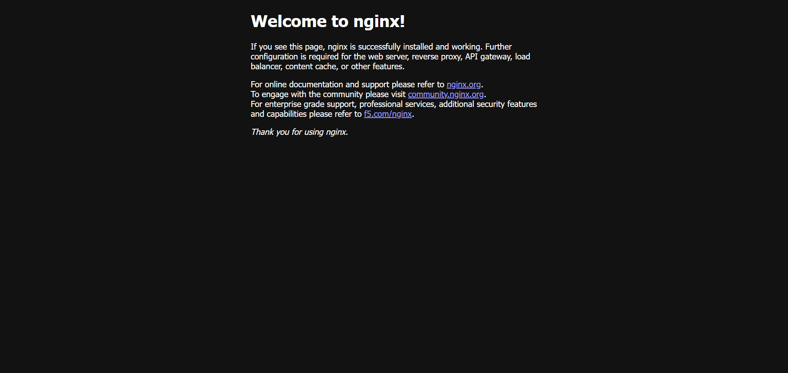

# Lab 01: Initializing Kubernetes Workloads with Minikube (Hello Pod)

## 1. Scenario & Objectives

In rapid-delivery production systems (such as Zepto's quick-commerce storefront), customer-facing endpoints require containerization for environment consistency, high availability, and rapid scaling. 

The primary objectives of this lab are:
- Initialize a local single-node Kubernetes cluster using **Minikube** backed by the Docker container runtime.
- Deploy an isolated storefront web workload using the standardized **Nginx** container image into a Kubernetes Pod.
- Expose the running Pod to external traffic across host boundaries via a **NodePort Service**.
- Establish an interactive network tunnel and verify end-to-end HTTP access in the browser.

---

## 2. Infrastructure & Environment Specifications

- **Operating System:** Windows 11 Home (x86_64)
- **Container Runtime:** Docker Desktop / Docker Engine 29.x
- **Kubernetes Control Plane:** v1.35.1
- **Cluster Orchestrator:** Minikube v1.38.1
- **CLI Utility:** `kubectl` v1.34+
- **Deployed Workload:** Nginx Web Server (Port 80)

---

## 3. Step-by-Step Implementation

### Step 1: Bootstrap the Local Kubernetes Cluster

Bring up the localized control plane node configured to use Docker as its driver:

```powershell
minikube start
```

*Execution Details:* Minikube allocates a dedicated virtualized control plane node (`minikube`), configures the bridge CNI (Container Networking Interface), configures storage provisioners, and automatically switches the active `kubectl` context to communicate with the newly spun-up cluster.

---

### Step 2: Provision the Workload Pod

Launch an initial workload named `hello-k8s` utilizing the official upstream Nginx container image:

```powershell
kubectl run hello-k8s --image=nginx --port=80
```

*Confirmation Output:*
```text
pod/hello-k8s created
```

---

### Step 3: Inspect Pod Lifecycle & Status

Validate that the Kubernetes Scheduler has assigned the Pod to the node and the container runtime has transitioned it into an active state:

```powershell
kubectl get pods
```

*Status Output:*
```text
NAME        READY   STATUS    RESTARTS   AGE
hello-k8s   1/1     Running   0          32s
```

*Diagnostic Note:* The `1/1` in the `READY` column signifies that all health checks passed and the primary container within the Pod is actively serving traffic without restarts.


---

### Step 4: Expose the Pod via a NodePort Service

By default, Pod IP addresses are ephemeral and internal to the cluster network overlay. To route external traffic into the container, expose `hello-k8s` using a `NodePort` service abstraction:

```powershell
kubectl expose pod hello-k8s --type=NodePort --port=80
```

*Confirmation Output:*
```text
service/hello-k8s exposed
```

---

### Step 5: Establish Service Tunnel & Access in Browser

Because Docker Desktop on Windows runs within an isolated virtualization layer, Minikube provides a helper to dynamically bridge host ports to the target service:

```powershell
minikube service hello-k8s
```

Minikube exposes the service on an allocated loopback tunnel (e.g., `http://127.0.0.1:58423`) and routes inbound HTTP connections directly to port 80 inside the container.



---

## 4. Kubernetes Control Plane Interaction Flow

When running the deployment commands, the internal control loop executes the following sequence:

```text
[ Developer CLI / kubectl ]
             │
             ▼
[ kube-apiserver ] <──────> [ etcd (Cluster State Store) ]
             │
             ├──> [ kube-scheduler ] (Evaluates resource criteria & assigns Node)
             │
             ▼
[ Worker Node / Kubelet ]
             │
             ├──> [ Container Runtime (Docker/containerd) ]
             │             │
             │             ▼
             │       [ Nginx Container ]
             │
             ▼
[ kube-proxy / NodePort Service ] ──> Routes Host Port to Pod Network Namespace
```

1. **`kubectl`** sends a JSON request over TLS to the `kube-apiserver`.
2. The API server authenticates and persists the desired Pod specification into **`etcd`**.
3. **`kube-scheduler`** detects the unassigned Pod and selects the worker node.
4. **`kubelet`** running on the node receives the Pod spec, commands the container runtime to pull the `nginx` image, sets up namespaces/cgroups, and launches the container.
5. **`kube-proxy`** programs local iptables / routing rules so that any packet reaching the NodePort is forwarded to the Pod's internal IP.

---

## 5. Summary of Commands

```bash
# Initialize cluster
minikube start

# Schedule Nginx Pod
kubectl run hello-k8s --image=nginx --port=80

# Query running resources
kubectl get pods

# Expose Pod through NodePort
kubectl expose pod hello-k8s --type=NodePort --port=80

# Access service endpoint via host tunnel
minikube service hello-k8s
```

---

## 6. Outcome & Verification

The Nginx web server was successfully containerized, deployed as a first-class Kubernetes Pod resource on a local Minikube cluster, exposed through a NodePort service, and verified via an active browser session with zero restart faults.
