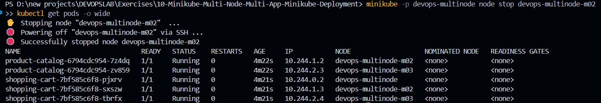

# Exercise 10: Multi-Node Kubernetes Topologies, Pod Anti-Affinity Scheduling, and Fault Recovery

## 1. Executive Summary & Objectives

In production cloud-native infrastructures, deploying workloads onto a solitary worker node introduces a severe Single Point of Failure (SPOF). Regardless of container replica counts, if the physical or virtual host fails, all co-located application instances terminate simultaneously. True High Availability (HA) demands distributed clustering where replicas are spread across distinct compute nodes.

This exercise implements a distributed multi-node Kubernetes architecture using a 3-node **Minikube** cluster. We deploy two decoupled microservices—a **Product Catalog** service (2 replicas) and a **Shopping Cart** service (3 replicas)—and enforce strict **Pod Anti-Affinity** rules to guarantee physical fault domain isolation across the cluster topology.

### Primary Learning Objectives:
- Bootstrap a multi-node Kubernetes cluster consisting of a dedicated control-plane node and two worker nodes (`devops-multinode`, `devops-multinode-m02`, `devops-multinode-m03`).
- Containerize two decoupled Flask microservices: **Product Catalog** (`product_catalog.py`) and **Shopping Cart** (`shopping_cart.py`).
- Implement cluster-wide image synchronization across multi-node topologies using `minikube image load` rather than external container registries.
- Author declarative Kubernetes Deployments incorporating strict `podAntiAffinity` rules (`requiredDuringSchedulingIgnoredDuringExecution`) with `topologyKey: kubernetes.io/hostname`.
- Expose workloads across host boundaries using **NodePort Services** and establish dynamic network tunnels.
- Validate end-to-end CRUD operations (`GET /products`, `GET /cart`, `POST /cart`) across distributed endpoints.
- Conduct a simulated node failure chaos drill (`minikube node stop`) to evaluate cluster node lease timers, eviction behavior, and high-availability resilience.

---

## 2. Infrastructure & Environment Specifications

- **Host Operating System:** Microsoft Windows 11 (x86_64)
- **Cluster Orchestrator:** Minikube v1.38.1 / v1.39.0
- **Virtualization Driver:** Docker Desktop Driver (`--driver=docker`)
- **Control Plane Version:** Kubernetes v1.35.1
- **Node Architecture:** 3 Virtual Nodes (1 Control-Plane, 2 Worker Nodes)
- **Cluster Profile:** `devops-multinode`
- **Deployed Microservices:**
  - **Product Catalog (AppA):** 2 Replicas, Port 80
  - **Shopping Cart (AppB):** 3 Replicas, Port 80

---

## 3. Distributed Architecture & Topology Map

```text
 ┌────────────────────────────────────────────────────────────────────────┐
 │                   Minikube Multi-Node Cluster Profile                  │
 │                        (devops-multinode)                              │
 └───────────────────────────────────┬────────────────────────────────────┘
                                     │
       ┌─────────────────────────────┼─────────────────────────────┐
       ▼                             ▼                             ▼
┌──────────────────────┐    ┌──────────────────────┐    ┌──────────────────────┐
│  Node 1: Control     │    │  Node 2: Worker 02   │    │  Node 3: Worker 03   │
│ (devops-multinode)   │    │(devops-multinode-m02)│    │(devops-multinode-m03)│
│                      │    │                      │    │                      │
│ ├── kube-apiserver   │    │ ├── Kubelet          │    │ ├── Kubelet          │
│ ├── etcd             │    │ ├── Kube-Proxy       │    │ ├── Kube-Proxy       │
│ └── Shopping Cart #1 │    │ ├── Product Cat. #1  │    │ ├── Product Cat. #2  │
│     (Pod Instance)   │    │ └── Shopping Cart #2 │    │ └── Shopping Cart #3 │
└──────────────────────┘    └──────────────────────┘    └──────────────────────┘
```

*Topology Rule Enforcement:*
- **Product Catalog (2 Replicas):** Scheduled exclusively across Worker 02 and Worker 03.
- **Shopping Cart (3 Replicas):** Distributed evenly with exactly one Pod replica per cluster node.

---

## 4. Application Architecture & Source Manifests

### 4.1 Product Catalog Microservice (`product_catalog.py`)

A RESTful catalog service exposing inventory metadata on `GET /products`:

```python
from flask import Flask, jsonify

app = Flask(__name__)

products = [
    {"id": 1, "name": "Laptop", "price": 1200},
    {"id": 2, "name": "Phone", "price": 800},
    {"id": 3, "name": "Headphones", "price": 150},
]

@app.route("/products", methods=["GET"])
def get_products():
    return jsonify(products)

if __name__ == "__main__":
    app.run(host="0.0.0.0", port=80)
```

---

### 4.2 Shopping Cart Microservice (`shopping_cart.py`)

A stateful in-memory transaction handler supporting item ingestion and retrieval:

```python
from flask import Flask, jsonify, request

app = Flask(__name__)

cart = []

@app.route("/cart", methods=["GET"])
def get_cart():
    return jsonify(cart)

@app.route("/cart", methods=["POST"])
def add_to_cart():
    item = request.json
    cart.append(item)
    return jsonify(cart), 201

if __name__ == "__main__":
    app.run(host="0.0.0.0", port=80)
```

---

### 4.3 Containerization Definitions

**`Dockerfile.product`:**
```dockerfile
FROM python:3.9-slim
WORKDIR /app
COPY product_catalog.py /app/
RUN pip install flask
CMD ["python", "product_catalog.py"]
```

**`Dockerfile.shopping`:**
```dockerfile
FROM python:3.9-slim
WORKDIR /app
COPY shopping_cart.py /app/
RUN pip install flask
CMD ["python", "shopping_cart.py"]
```

---

### 4.4 Declarative Deployments with Pod Anti-Affinity

#### Product Catalog Deployment (`product_catalog_deployment.yaml`)
Enforces `replicas: 2` and guarantees that the Kubernetes Scheduler will reject scheduling a Pod onto any node already executing a workload labeled `app: product-catalog`:

```yaml
apiVersion: apps/v1
kind: Deployment
metadata:
  name: product-catalog
  labels:
    app: product-catalog
spec:
  replicas: 2
  selector:
    matchLabels:
      app: product-catalog
  template:
    metadata:
      labels:
        app: product-catalog
    spec:
      affinity:
        podAntiAffinity:
          requiredDuringSchedulingIgnoredDuringExecution:
          - labelSelector:
              matchLabels:
                app: product-catalog
            topologyKey: "kubernetes.io/hostname"
      containers:
      - name: product-catalog
        image: product-catalog:latest
        imagePullPolicy: Never
        ports:
        - containerPort: 80
```

#### Shopping Cart Deployment (`shopping_cart_deployment.yaml`)
Enforces `replicas: 3` with hard anti-affinity across the three cluster nodes:

```yaml
apiVersion: apps/v1
kind: Deployment
metadata:
  name: shopping-cart
  labels:
    app: shopping-cart
spec:
  replicas: 3
  selector:
    matchLabels:
      app: shopping-cart
  template:
    metadata:
      labels:
        app: shopping-cart
    spec:
      affinity:
        podAntiAffinity:
          requiredDuringSchedulingIgnoredDuringExecution:
          - labelSelector:
              matchLabels:
                app: shopping-cart
            topologyKey: "kubernetes.io/hostname"
      containers:
      - name: shopping-cart
        image: shopping-cart:latest
        imagePullPolicy: Never
        ports:
        - containerPort: 80
```

---

### 4.5 Service Manifests

**`product_catalog_service.yaml`:**
```yaml
apiVersion: v1
kind: Service
metadata:
  name: product-catalog-service
spec:
  selector:
    app: product-catalog
  ports:
  - protocol: TCP
    port: 80
    targetPort: 80
  type: NodePort
```

**`shopping_cart_service.yaml`:**
```yaml
apiVersion: v1
kind: Service
metadata:
  name: shopping-cart-service
spec:
  selector:
    app: shopping-cart
  ports:
  - protocol: TCP
    port: 80
    targetPort: 80
  type: NodePort
```

---

## 5. Step-by-Step Implementation & Execution Record

### Step 1: Provision Multi-Node Cluster

Clean stale clusters and initialize three distinct virtual nodes under the `devops-multinode` profile:

```powershell
minikube delete --all
minikube start --nodes 3 -p devops-multinode --driver=docker
kubectl get nodes
```

*Cluster Node Table:*
```text
NAME                   STATUS   ROLES           AGE     VERSION
devops-multinode       Ready    control-plane   2m29s   v1.35.1
devops-multinode-m02   Ready    <none>          82s     v1.35.1
devops-multinode-m03   Ready    <none>          48s     v1.35.1
```

All three nodes successfully initialize and transition to the `Ready` operational state.


---

### Step 2: Build & Propagate Container Images Across All Nodes

In multi-node architectures, images built on the local host are not automatically present on remote worker nodes. We compile the images and load them into the Minikube cluster cache:

```powershell
# 1. Build images on host Docker runtime
docker build -t product-catalog:latest -f Dockerfile.product .
docker build -t shopping-cart:latest -f Dockerfile.shopping .

# 2. Inject images across all nodes in the cluster profile
minikube -p devops-multinode image load product-catalog:latest
minikube -p devops-multinode image load shopping-cart:latest

# 3. Verify presence inside Minikube node daemon
minikube -p devops-multinode ssh -- docker images
```

*Verification:* Output displays both application images loaded alongside Kubernetes control plane images.


---

### Step 3: Deploy Manifests & Validate Pod Distribution

Apply both Deployments and NodePort Services, then verify Pod placement across nodes:

```powershell
kubectl apply -f product_catalog_deployment.yaml
kubectl apply -f shopping_cart_deployment.yaml
kubectl apply -f product_catalog_service.yaml
kubectl apply -f shopping_cart_service.yaml

kubectl get pods -o wide
```

*Pod Scheduling Distribution:*
- **`product-catalog` Replicas:** Scheduled on `devops-multinode-m02` and `devops-multinode-m03`.
- **`shopping-cart` Replicas:** Scheduled across `devops-multinode` (control-plane), `devops-multinode-m02`, and `devops-multinode-m03`.
- **Anti-Affinity Validation:** Exactly zero nodes host duplicate Pods of the same service.


---

### Step 4: Establish Service Tunnels

Bridge host loopback ports to the cluster NodePort services across separate terminals:

```powershell
# Terminal A (Product Catalog Service Tunnel)
minikube -p devops-multinode service product-catalog-service --url

# Terminal B (Shopping Cart Service Tunnel)
minikube -p devops-multinode service shopping-cart-service --url
```

*Allocated Tunnel Endpoints:*
- Product Catalog: `http://127.0.0.1:56362`
- Shopping Cart: `http://127.0.0.1:54630`

---

### Step 5: End-to-End Microservice Functional Verification

Dispatch HTTP verification requests against the tunneled endpoints:

```powershell
# 1. Fetch available catalog items
curl.exe http://127.0.0.1:56362/products

# 2. Inspect initial shopping cart state (empty)
curl.exe http://127.0.0.1:54630/cart

# 3. Post a new order item into the cart
Invoke-RestMethod -Method Post -Uri http://127.0.0.1:54630/cart -ContentType "application/json" -Body '{ "id": 1, "name": "Laptop", "quantity": 1 }'

# 4. Verify persisted cart content
curl.exe http://127.0.0.1:54630/cart
```

*Response Verification:*
- `/products`: Returns catalog array containing `Laptop` ($1200), `Phone` ($800), and `Headphones` ($150).
- `POST /cart`: Successfully records the `Laptop` object, returning HTTP 201 Created.
- Final `GET /cart`: Emits the updated order payload.


---

### Step 6: Fault Tolerance Chaos Drill (Worker Node Termination)

Simulate physical hardware failure by forcefully halting worker node `devops-multinode-m02`:

```powershell
minikube -p devops-multinode node stop devops-multinode-m02
kubectl get pods -o wide
```

*Fault Recovery Analysis:*
1. Minikube halts the virtual node instance `devops-multinode-m02`.
2. The remaining nodes (`devops-multinode` and `devops-multinode-m03`) continue executing unaffected Pods.
3. Kube-Proxy automatically ceases routing inbound traffic to endpoints located on the unreachable node.
4. Because multiple replicas remain online on healthy nodes, both the Product Catalog and Shopping Cart APIs continue serving client traffic without interruption.



Restore node capacity post-drill:
```powershell
minikube -p devops-multinode node start devops-multinode-m02
```

---

## 6. Pod Anti-Affinity Scheduling Mechanics

```text
               ┌──────────────────────────────────────┐
               │    Pod Submission (product-catalog)  │
               └──────────────────┬───────────────────┘
                                  │
                                  ▼
               ┌──────────────────────────────────────┐
               │         Kubernetes Scheduler         │
               └──────────────────┬───────────────────┘
                                  │
                  Evaluates Filter & Predicate Rules
                                  │
      ┌───────────────────────────┼───────────────────────────┐
      │                           │                           │
      ▼                           ▼                           ▼
[ Node: devops-multinode ]  [ Node: devops-multinode-m02 ] [ Node: devops-multinode-m03 ]
      │                           │                           │
Already running cart?      Contains product-catalog?   Empty slot for catalog?
      │                           │                           │
      ▼                           ▼                           ▼
  Compatible                  REJECTED (Anti-Affinity)     ACCEPTED & SCHEDULED
```

- **`requiredDuringSchedulingIgnoredDuringExecution`:** Hard constraint. If no available node satisfies the anti-affinity requirement, the Pod remains in `Pending` state rather than violating colocation rules.
- **`topologyKey: "kubernetes.io/hostname"`:** Defines the failure boundary. The scheduler treats each unique node hostname as an isolated failure domain.

---

## 7. Concept Mastery & Laboratory Q&A

**Q1. What is the fundamental difference between single-node and multi-node Kubernetes clusters?**  
*Answer:* A single-node cluster runs the control plane and workloads on the same physical host, meaning host failure terminates the entire system. Multi-node clusters partition the control plane and distribute worker workloads across distinct physical or virtual hosts, achieving true physical fault tolerance and horizontal compute scaling.

**Q2. Why is `minikube image load` preferred over `eval $(minikube docker-env)` in multi-node Minikube clusters?**  
*Answer:* `minikube docker-env` points the host Docker CLI exclusively to the primary control-plane node daemon. In a multi-node cluster, worker nodes (`m02`, `m03`) have isolated internal container runtimes. Running `minikube image load <image>` distributes the image artifact across all nodes in the profile.

**Q3. How does `podAntiAffinity` prevent service downtime?**  
*Answer:* By configuring `podAntiAffinity` with `topologyKey: kubernetes.io/hostname`, Kubernetes guarantees that replicas of the same service are scheduled onto different physical or virtual nodes. If a single node experiences hardware failure or network loss, surviving replicas on other nodes continue serving client traffic.

**Q4. What is the default eviction behavior when a Kubernetes node stops responding?**  
*Answer:* The Node Controller observes missed node heartbeats and marks the node `NotReady` after the node-monitor grace period (default 40s). By default, Pods on unreachable nodes enter a termination grace period (default 300s / 5 minutes) before the controller evicts them and schedules replacements on surviving nodes.

---

## 8. Summary of Executed Commands

```powershell
# 1. Cluster Reset & Multi-Node Provisioning
minikube delete --all
minikube start --nodes 3 -p devops-multinode --driver=docker
kubectl get nodes

# 2. Image Build & Multi-Node Propagation
docker build -t product-catalog:latest -f Dockerfile.product .
docker build -t shopping-cart:latest -f Dockerfile.shopping .
minikube -p devops-multinode image load product-catalog:latest
minikube -p devops-multinode image load shopping-cart:latest

# 3. Workload & Service Deployment
kubectl apply -f product_catalog_deployment.yaml
kubectl apply -f shopping_cart_deployment.yaml
kubectl apply -f product_catalog_service.yaml
kubectl apply -f shopping_cart_service.yaml
kubectl get pods -o wide

# 4. Tunneling & Functional Validation
minikube -p devops-multinode service product-catalog-service --url
minikube -p devops-multinode service shopping-cart-service --url
curl.exe http://127.0.0.1:56362/products
curl.exe http://127.0.0.1:54630/cart
Invoke-RestMethod -Method Post -Uri http://127.0.0.1:54630/cart -ContentType "application/json" -Body '{ "id": 1, "name": "Laptop", "quantity": 1 }'

# 5. Fault Tolerance Drill & Recovery
minikube -p devops-multinode node stop devops-multinode-m02
kubectl get pods -o wide
minikube -p devops-multinode node start devops-multinode-m02
```

---

## 9. Final Lab Verification & Conclusion

The multi-node, multi-application Kubernetes architecture was successfully provisioned across 3 virtual nodes. The Product Catalog and Shopping Cart microservices were containerized, synchronized across all nodes, and deployed using declarative manifests with strict Pod anti-affinity. End-to-end API operations were validated over NodePort tunnels, and fault tolerance was demonstrated by stopping a worker node while observing continuous application availability across the surviving cluster topology.
