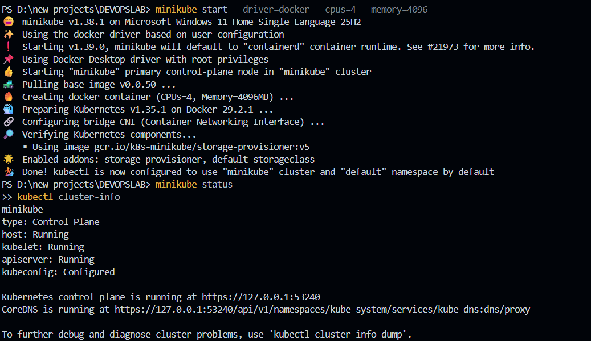
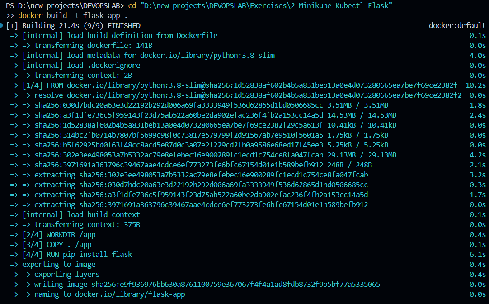
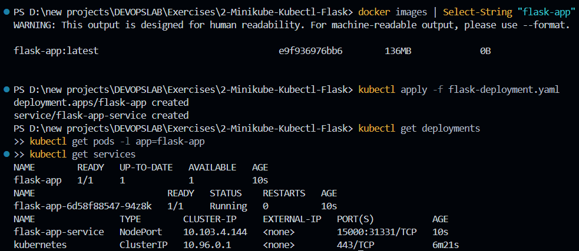
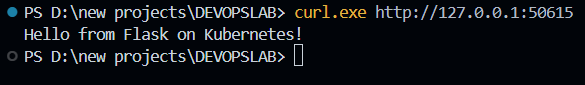

# Lab 02: Deploying a Containerized Flask Microservice on Kubernetes via Declarative Manifests

## 1. Executive Summary & Objective

While deploying pre-built images (such as Nginx) demonstrates basic container scheduling, production DevOps workflows require packaging bespoke internal application code, building compliant container images, and managing workload states through declarative configuration files.

The primary objectives of this lab are:
- Build a lightweight Python Flask microservice listening on non-standard port `15000`.
- Package the application into a container image using a multi-layer `Dockerfile`.
- Target Minikube's internal container engine to build the image locally without requiring an external container registry.
- Author and apply a declarative Kubernetes manifest defining both a `Deployment` controller and a `NodePort` `Service`.
- Expose the microservice across the host-virtualization boundary using Minikube network tunneling and validate end-to-end HTTP responses.

---

## 2. Infrastructure & Environment Specifications

- **Host Operating System:** Microsoft Windows 11
- **Kubernetes Engine:** Minikube v1.38.1
- **Driver / Virtualization:** Docker Desktop Driver (`--driver=docker`)
- **Allocated Resources:** 4 Virtual CPUs, 4096 MB Memory
- **Container Runtime:** Docker 29.x (Minikube internal daemon)
- **Application Stack:** Python 3.8-slim base image, Flask micro-framework
- **Workload Port:** `15000/TCP`

---

## 3. Application Architecture & Source Manifests

### 3.1 Web Application Code (`app.py`)

A minimal Flask application configured to bind across all network interfaces within the container namespace:

```python
from flask import Flask

app = Flask(__name__)

@app.route('/')
def home():
    return "Hello from Flask on Kubernetes!"

if __name__ == '__main__':
    app.run(host='0.0.0.0', port=15000)
```

> **Design Consideration:** Binding to `0.0.0.0` is essential for containerized services. If bound to `127.0.0.1`, the server would only accept requests originating from within its own local container loopback, rejecting connections forwarded by the Kubernetes Service proxy.

---

### 3.2 Container Image Definition (`Dockerfile`)

```dockerfile
FROM python:3.8-slim
WORKDIR /app
COPY . /app
RUN pip install flask
CMD ["python", "app.py"]
```

The build specification utilizes the minimal Debian-based `python:3.8-slim` footprint, establishes `/app` as the active working directory, copies the project context, installs the Flask dependency, and defines the container execution entrypoint.

---

### 3.3 Declarative Kubernetes Manifest (`flask-deployment.yaml`)

Both the workload manager (`Deployment`) and network entrypoint (`Service`) are consolidated into a single declarative configuration:

```yaml
apiVersion: apps/v1
kind: Deployment
metadata:
  name: flask-app
spec:
  replicas: 1
  selector:
    matchLabels:
      app: flask-app
  template:
    metadata:
      labels:
        app: flask-app
    spec:
      containers:
      - name: flask-app
        image: flask-app:latest
        imagePullPolicy: Never
        ports:
        - containerPort: 15000
---
apiVersion: v1
kind: Service
metadata:
  name: flask-app-service
spec:
  selector:
    app: flask-app
  ports:
  - port: 15000
    targetPort: 15000
  type: NodePort
```

#### Manifest Key Parameters:
1. **`imagePullPolicy: Never`**: Instructs the Kubelet to exclusively look for `flask-app:latest` in the node's local image cache. If omitted or set to `Always`, Kubernetes would attempt to query public Docker Hub registries and fail with `ErrImagePull` / `ImagePullBackOff`.
2. **`matchLabels: { app: flask-app }`**: Establishes the label selector coupling the Deployment controller to its managed Pod instances.
3. **`targetPort: 15000`**: Routes inbound traffic hitting service port `15000` directly to container port `15000`.
4. **`type: NodePort`**: Exposes the service on each node's IP at a statically or dynamically allocated high port (in the 30000–32767 range).

---

## 4. Step-by-Step Implementation & Verification

### Step 1: Cluster Initialization and Resource Check

Provision the Minikube cluster with explicit CPU and memory reservations:

```powershell
minikube start --driver=docker --cpus=4 --memory=4096
minikube status
kubectl cluster-info
```

*Verification:* The control plane components (`kube-apiserver`, `kubelet`, `CoreDNS`) successfully initialize, and `kubectl` establishes an active context pointing to the local cluster endpoint (`https://127.0.0.1:53240`).



---

### Step 2: Target Minikube's Docker Environment

To avoid the overhead of setting up a remote registry, point the local shell's Docker client commands directly to the Docker engine inside Minikube:

```powershell
& minikube docker-env | Invoke-Expression
```

*(Note for Windows PowerShell: The standard Linux `eval $(minikube docker-env)` syntax is substituted with the call operator `&` and `Invoke-Expression`.)*

---

### Step 3: Build the Container Image

Build the container image directly within Minikube's local storage:

```powershell
docker build -t flask-app .
```

Docker sequentially processes all layers (base image extraction, context copying, and `pip install`), registering the resulting `flask-app:latest` artifact (~136 MB) in Minikube's internal engine.



---

### Step 4: Apply Manifest & Validate Workload Status

Confirm the presence of the built image and apply the declarative configuration:

```powershell
docker images | Select-String "flask-app"
kubectl apply -f flask-deployment.yaml

kubectl get deployments
kubectl get pods -l app=flask-app
kubectl get services
```

*Observed State:*
- **Deployment:** `flask-app` reports `1/1` replicas available and up-to-date.
- **Pod:** `flask-app-6d58f88547-94z8k` reaches `Running` status with `0` restarts.
- **Service:** `flask-app-service` allocates a NodePort mapping `15000:31331/TCP`.



---

### Step 5: Establish Network Tunneling & Access

Because Docker Desktop runs within an isolated Hyper-V/WSL2 network namespace on Windows, node ports cannot be reached directly via `localhost:<NodePort>`. Minikube resolves this through dynamic port forwarding:

```powershell
minikube service flask-app-service --url
```

*Allocated Tunnel URL:*
```text
http://127.0.0.1:50615
! Because you are using a Docker driver on windows, the terminal needs to be open to run it.
```


---

### Step 6: Functional Testing via HTTP Request

In a concurrent terminal, dispatch an HTTP GET request to the tunneled endpoint:

```powershell
curl.exe http://127.0.0.1:50615
```

*Response Received:*
```text
Hello from Flask on Kubernetes!
```

The expected text is returned instantaneously, proving that traffic traverses the entire path: **Host Client $\to$ Minikube Tunnel $\to$ NodePort Service Proxy $\to$ Pod Network $\to$ Flask Microservice**.



---

## 5. End-to-End Traffic Routing Flow

```text
[ Client Request: curl http://127.0.0.1:50615 ]
                        │
                        ▼
            [ Minikube Host Tunnel ]
                        │
                        ▼
       [ Worker Node NodePort: 31331/TCP ]
                        │
                        ▼
         [ Service Proxy: flask-app-service ]
                        │
                        ▼
             [ Target Port: 15000 ]
                        │
                        ▼
        [ Pod: flask-app-6d58f88547-94z8k ]
                        │
                        ▼
        [ Python Flask WSGI (0.0.0.0:15000) ]
```

---

## 6. Key Operational Insights & Gotchas

1. **PowerShell Alias Handling:**
   - In PowerShell, typing `curl` invokes `Invoke-WebRequest`, which wraps output into a verbose .NET object. Calling `curl.exe` ensures the native curl binary outputs the clean raw payload.
2. **Environment Variable Injection:**
   - The environment variables produced by `minikube docker-env` are scoped to the current terminal session only. Any new terminal tab must execute `& minikube docker-env | Invoke-Expression` before executing image builds.
3. **Image Cache Persistence:**
   - With `imagePullPolicy: Never`, the image name specified in the Deployment YAML must match the tag supplied during `docker build` exactly (`flask-app:latest`).
4. **Tunnel Lifecycle:**
   - The `minikube service --url` process must remain active in its host terminal; terminating that process immediately drops the port proxy.

---

## 7. Results & Completion

The custom Python Flask application was successfully containerized, imported into the cluster's local container engine, deployed via declarative Kubernetes YAML manifests, and thoroughly verified with live HTTP traffic over a NodePort service proxy tunnel.
