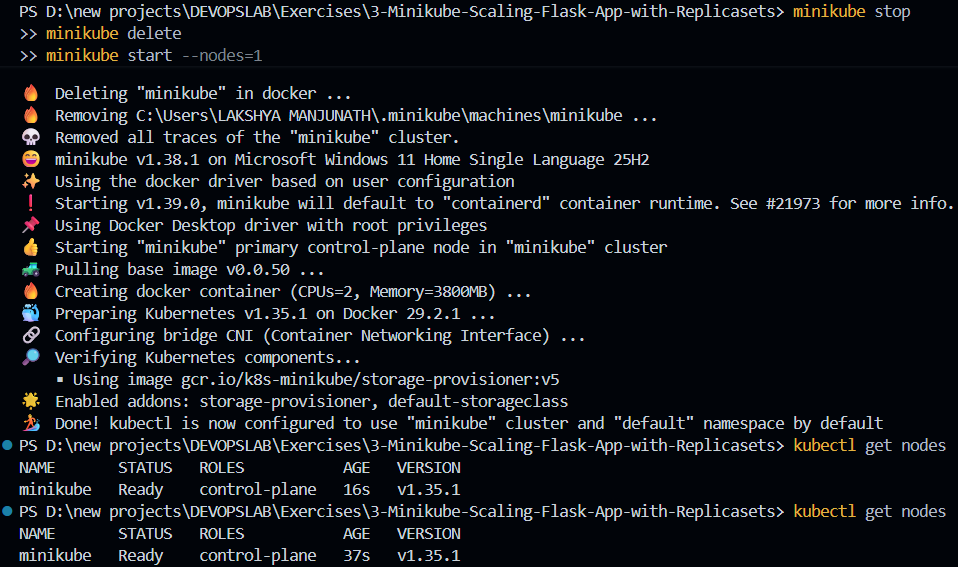
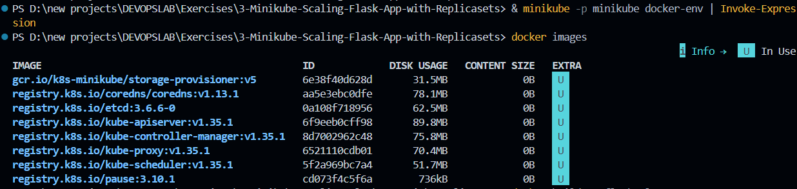
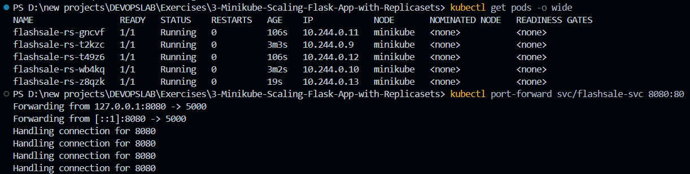

# Exercise 03: Scalable Microservice Deployment & Fault Recovery using Kubernetes ReplicaSets

## 1. Executive Summary & Objectives

In high-concurrency production platforms, executing services as isolated, single-instance containers introduces a critical Single Point of Failure (SPOF). During event-driven traffic surges—such as flash sales or product drops—unreplicated workloads rapidly exhaust system memory and thread pools, causing catastrophic service outages.

This laboratory focuses on engineering application resilience through the **Kubernetes ReplicaSet** controller. By decoupling application replication from physical host constraints, Kubernetes continuously orchestrates container lifecycles to satisfy a declarative operational contract.

### Key Learning Objectives:
- Implement a Python Flask microservice configured with endpoints for business transactions (`/buy`), landing traffic (`/`), and container health validation (`/health`).
- Package the application using production-ready WSGI workers (**Gunicorn**) within a multi-stage Docker build.
- Target Minikube's localized Docker runtime environment to build and register the container image without external registry overhead.
- Construct a declarative manifest defining both a multi-pod **ReplicaSet** (specifying 3 initial replicas with CPU/memory quotas and readiness/liveness probes) and a **ClusterIP Service**.
- Demonstrate the **Kubernetes Reconciliation Loop** via deliberate fault injection (deleting an active Pod and validating sub-second self-healing).
- Perform dynamic horizontal scaling to adjust workload capacity in response to simulated traffic demands.
- Establish an interactive network bridge via Kubernetes port-forwarding and verify request distribution across unique Pod hostnames.

---

## 2. Infrastructure & Environment Specifications

- **Host Operating System:** Microsoft Windows 11
- **Orchestration Engine:** Minikube v1.39.0
- **Container Runtime:** Docker Desktop / Docker Engine 29.x
- **Kubernetes Version:** v1.35.1
- **CLI Utility:** `kubectl` v1.34+
- **Application Stack:** Python 3.11-slim, Flask, Gunicorn WSGI
- **Internal Service Target:** Port `5000/TCP` exposed via Service Port `80/TCP`

---

## 3. Real-World Engineering Scenario: E-Commerce Flash Sale

Consider a high-velocity quick-commerce backend (e.g., Flipkart Big Billion Days, Amazon Prime Day, or Zepto Super Saver events):
- Under baseline conditions, the checkout service processes approximately 100 transactions per minute on a modest resource allocation.
- At the start of a flash sale, incoming traffic spikes by two orders of magnitude (10,000+ requests per minute).
- If deployed as a solitary Pod, CPU saturation and TCP connection backlogs cause connection timeouts and lost revenue.
- Utilizing a **ReplicaSet**, the orchestration layer expands the workload footprint across multiple stateless Pod clones, distributing incoming HTTP requests evenly.
- Following event conclusion, the operator scales the replica count down, freeing cluster resources for other workloads.

---

## 4. Application Architecture & Source Manifests

### 4.1 Microservice Application Source (`app.py`)

The application exposes three primary routes. The `/buy` route simulates an e-commerce checkout transaction, assigns a mock product and user identity, and records the specific container hostname executing the request:

```python
from flask import Flask, request
import socket, time, random

app = Flask(__name__)

@app.get("/")
def homepage():
    return {
        "message": "Welcome to Big Sale!",
        "pod": socket.gethostname(),
        "ts": time.time()
    }

@app.get("/buy")
def buy():
    item = random.choice(["Smartphone", "Shoes", "Headphones", "Laptop"])
    user = request.args.get("user", f"user{random.randint(1,1000)}")
    return {
        "status": "success",
        "item": item,
        "user": user,
        "served_by_pod": socket.gethostname(),
        "time": time.strftime("%H:%M:%S")
    }

@app.get("/health")
def health():
    return {"status": "healthy", "pod": socket.gethostname()}
```

*Architectural Detail:* In containerized Linux environments, `socket.gethostname()` returns the UTS namespace hostname, which Kubernetes dynamically configures to match the unique Pod name assigned by the scheduler.

---

### 4.2 Production Dockerfile (`Dockerfile`)

The container image employs the slim Debian Python distribution, installs production-grade WSGI middleware (`gunicorn`), and establishes worker concurrency:

```dockerfile
FROM python:3.11-slim
WORKDIR /app
COPY app.py .
RUN pip install --no-cache-dir flask gunicorn
CMD ["gunicorn", "-b", "0.0.0.0:5000", "app:app", "--workers", "1", "--threads", "2"]
```

---

### 4.3 Declarative Kubernetes Manifest (`flashsale-replicaset.yaml`)

The declarative specification defines the desired state contract for both the ReplicaSet controller and the internal network proxy (`ClusterIP` Service):

```yaml
apiVersion: apps/v1
kind: ReplicaSet
metadata:
  name: flashsale-rs
  labels:
    app: flashsale
spec:
  replicas: 3
  selector:
    matchLabels:
      app: flashsale
  template:
    metadata:
      labels:
        app: flashsale
    spec:
      containers:
      - name: flashsale-container
        image: flashsale:1.0
        imagePullPolicy: Never
        ports:
        - containerPort: 5000
        readinessProbe:
          httpGet:
            path: /health
            port: 5000
          initialDelaySeconds: 2
          periodSeconds: 5
        livenessProbe:
          httpGet:
            path: /health
            port: 5000
          initialDelaySeconds: 10
          periodSeconds: 10
        resources:
          requests:
            cpu: "100m"
            memory: "128Mi"
          limits:
            cpu: "500m"
            memory: "256Mi"
---
apiVersion: v1
kind: Service
metadata:
  name: flashsale-svc
spec:
  selector:
    app: flashsale
  ports:
  - name: http
    port: 80
    targetPort: 5000
  type: ClusterIP
```

#### Key Technical Parameters:
1. **`imagePullPolicy: Never`**: Instructs the node Kubelet to source the image strictly from the local Docker runtime cache, preventing erroneous outbound registry lookups.
2. **`matchLabels: { app: flashsale }`**: Declares the label selector criteria that couples the ReplicaSet controller to its supervised Pod instances.
3. **`readinessProbe` & `livenessProbe`**: Actively queries `/health` on port 5000. Readiness probes prevent traffic routing before the Gunicorn socket binds; liveness probes restart containers experiencing deadlock.
4. **`Service (ClusterIP)`**: Allocates an internal virtual IP on port 80 and maps inbound traffic across healthy target Pod endpoints on port 5000.

---

## 5. Step-by-Step Implementation & Execution Record

### Step 1: Initialize Single-Node Minikube Cluster

Clean any pre-existing cluster state and bootstrap a clean single-node control plane:

```powershell
minikube stop
minikube delete
minikube start --nodes=1
kubectl get nodes
```

*Cluster Node Verification:*
```text
NAME       STATUS   ROLES           AGE   VERSION
minikube   Ready    control-plane   1m    v1.35.1
```



---

### Step 2: Configure Terminal Docker Context to Minikube Daemon

Redirect the host's Docker client commands directly to Minikube's internal Docker daemon:

```powershell
& minikube -p minikube docker-env | Invoke-Expression
docker images
```

*Output:* Confirms access to Minikube's internal container cache containing core Kubernetes images (`storage-provisioner`, `coredns`, `kube-apiserver`).



---

### Step 3: Build the Flash Sale Microservice Image

Execute the container image build directly inside the Minikube environment:

```powershell
docker build -t flashsale:1.0 .
docker images | findstr flashsale
```

*Artifact Confirmation:*
```text
flashsale:1.0   ea151d319009   143MB
```


---

### Step 4: Apply Declarative ReplicaSet & Service Manifest

Deploy the combined ReplicaSet controller and ClusterIP service into the active namespace:

```powershell
kubectl apply -f flashsale-replicaset.yaml
```

*Confirmation Output:*
```text
replicaset.apps/flashsale-rs created
service/flashsale-svc created
```

---

### Step 5: Validate Replication, Scale Workload & Observe Self-Healing

Verify the initial 3 replicas, dynamically scale the capacity to 5, and conduct chaos verification by deleting an active Pod:

```powershell
kubectl get rs
kubectl get pods
kubectl scale rs flashsale-rs --replicas=5
kubectl get rs
kubectl get pods
kubectl delete pod flashsale-rs-6tm6x
kubectl get pods
```

*State Inspection:*
```text
NAME           DESIRED   CURRENT   READY   AGE
flashsale-rs   5         5         5       2m10s

NAME                 READY   STATUS    RESTARTS   AGE
flashsale-rs-gncvf   1/1     Running   0          2m15s
flashsale-rs-t2kzc   1/1     Running   0          2m15s
flashsale-rs-t49z6   1/1     Running   0          2m15s
flashsale-rs-wb4kq   1/1     Running   0          45s
flashsale-rs-z8qzk   1/1     Running   0          45s
```

*Fault Recovery Mechanism:* Upon issuing `kubectl delete pod`, the ReplicaSet controller detects that `activeReplicas (4) < desiredReplicas (5)`. Within milliseconds, the controller interacts with `kube-apiserver` to schedule an immediate replacement Pod, preserving system availability with zero operator intervention.


---

### Step 6: Pod Topology Inspection & Port Forwarding

Review Pod IP allocations and forward local port `8080` to the ClusterIP Service:

```powershell
kubectl get pods -o wide
kubectl port-forward svc/flashsale-svc 8080:80
```

*Network Details:* Each Pod receives an isolated overlay IP address within `10.244.0.0/16`, running on the single `minikube` node. Port forwarding bridges `127.0.0.1:8080` directly to the Service abstraction:

```text
Forwarding from 127.0.0.1:8080 -> 80
Handling connection for 8080
```



---

### Step 7: Access and Traffic Distribution Verification (`/buy`)

In a concurrent PowerShell window, dispatch sequential HTTP requests to the forwarded endpoint:

```powershell
Invoke-RestMethod http://localhost:8080/buy
```

**Transaction Verification 1 (Shoes):**
```json
{
  "item": "Shoes",
  "served_by_pod": "flashsale-rs-t2kzc",
  "status": "success",
  "time": "18:29:24",
  "user": "user363"
}
```


**Transaction Verification 2 (Smartphone):**
```json
{
  "item": "Smartphone",
  "served_by_pod": "flashsale-rs-t49z6",
  "status": "success",
  "time": "18:29:45",
  "user": "user580"
}
```


*Validation Analysis:* The alternating values of `served_by_pod` confirm that Kubernetes internal service proxies (Kube-Proxy and EndpointSlices) are actively load-balancing incoming HTTP traffic across healthy replica Pods.

---

## 6. Architectural Mechanics: The Kubernetes Reconciliation Cycle

The autonomous scaling and recovery observed in this exercise operates via the Kubernetes control loop:

```text
  [ kubectl CLI ]
         │ (Declares spec.replicas: 5)
         ▼
  [ kube-apiserver ] <────> [ etcd Datastore ]
         │
         ▼
  [ ReplicaSet Controller ] ◄────────────────────────────────────┐
         │                                                       │
         ├── Compares Desired State (5) vs Observed State (N)    │ Continuous
         │                                                       │ Watch Loop
         ├── If Observed < Desired: Requests Pod Scheduling      │
         └── If Observed > Desired: Selects Pods for Termination │
         │                                                       │
         ▼                                                       │
  [ kube-scheduler ] ──> Assigns Node                            │
         │                                                       │
         ▼                                                       │
  [ Kubelet on Node ] ──> Instructs Container Runtime (Docker) ──┘
```

1. **Declarative State Storage:** The API server writes the target manifest state to `etcd`.
2. **Controller Reconciliation:** The `kube-controller-manager` runs the ReplicaSet controller, which continuously queries actual cluster state against the stored specification.
3. **Automated Remediation:** Discrepancies trigger imperative lifecycle events to restore parity immediately.

---

## 7. Technical Review & Concept Mastery Q&A

**Q1. What is the initial baseline replica count defined in the ReplicaSet?**  
*Answer:* The initial specification defines `replicas: 3`.

**Q2. How many Pod instances exist immediately following manifest application?**  
*Answer:* Exactly 3 Pod instances transition to the `Running` state, matching the initial contract.

**Q3. What operational sequence occurs when scaling the ReplicaSet to 5 replicas?**  
*Answer:* The ReplicaSet controller detects that observed count (3) is lower than desired count (5). It requests the scheduler to create 2 additional Pods, which the Kubelet starts via the container runtime.

**Q4. What behavior is observed when an active Pod is forcefully deleted?**  
*Answer:* The controller loop detects `actual (4) < desired (5)`, immediately scheduling a replacement Pod to guarantee uninterrupted service availability.

**Q5. How does Kubernetes enforce target replica counts without human intervention?**  
*Answer:* Through the continuous reconciliation loop running in `kube-controller-manager`, which continuously reconciles discrepancies between the observed cluster state and the desired state in `etcd`.

**Q6. How many physical/virtual nodes are active in this configuration?**  
*Answer:* 1 control-plane node (`minikube`).

**Q7. What is the spatial distribution of the Pods across cluster infrastructure?**  
*Answer:* All 5 Pod instances are scheduled onto the solitary `minikube` node, each allocated its own unique internal IP address (`10.244.0.x`) within the container overlay network.

---

## 8. Summary of Executed Commands

```powershell
# 1. Cluster Initialization
minikube stop
minikube delete
minikube start --nodes=1
kubectl get nodes

# 2. Docker Daemon Redirection
& minikube -p minikube docker-env | Invoke-Expression
docker images

# 3. Local Container Build
docker build -t flashsale:1.0 .
docker images | findstr flashsale

# 4. Declarative Deployment
kubectl apply -f flashsale-replicaset.yaml

# 5. Controller Inspection & Scaling Drill
kubectl get rs
kubectl get pods
kubectl scale rs flashsale-rs --replicas=5
kubectl delete pod <pod-name>
kubectl get pods -o wide

# 6. Service Exposure & Validation
kubectl port-forward svc/flashsale-svc 8080:80
Invoke-RestMethod http://localhost:8080/buy
```

---

## 9. Final Lab Verification & Conclusion

The Flash Sale microservice was successfully packaged into a compliant Docker image within Minikube's local container engine, deployed via declarative ReplicaSet manifests, and horizontally scaled from 3 to 5 instances. Fault tolerance was demonstrated under simulated Pod termination, confirming automated self-healing. Finally, network traffic was tunneled to the ClusterIP Service, verifying end-to-end load distribution across distinct container replicas.
