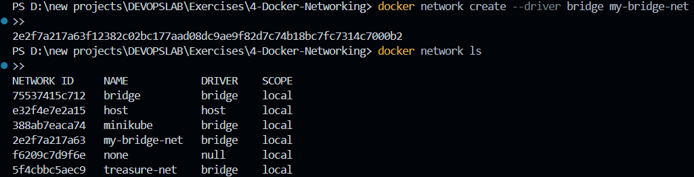
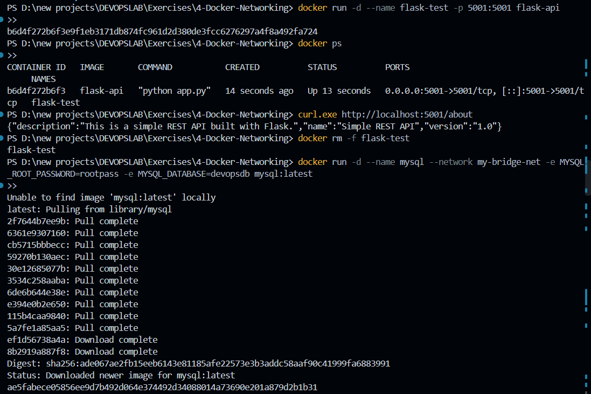

# Exercise 04: Multi-Container Orchestration and Service Discovery via Docker Bridge Networks

## 1. Executive Summary & Objectives

In production microservices architectures, decoupled components—such as web frontends, transactional relational databases, and in-memory caching layers—must interact over low-latency, private network fabrics. Exposing all service ports directly to host interfaces creates severe attack surfaces and port conflicts.

This exercise explores container network isolation, private bridging, and service discovery using **Docker User-Defined Bridge Networks**. By deploying a three-tier polyglot stack comprising a **Python Flask REST API**, an **official MySQL database**, and a **Redis in-memory cache**, we demonstrate how containerized workloads achieve DNS-driven name resolution without hardcoding ephemeral IP addresses.

### Primary Learning Objectives:
- Provision and inspect an isolated user-defined Docker bridge network (`my-bridge-net`) specifying customized subnet ranges.
- Containerize a Python Flask microservice using pinned dependency baselines to guarantee runtime compatibility.
- Execute standalone pre-flight container validation before attaching dependencies to the custom bridge network.
- Deploy a multi-container ecosystem (Flask web API, MySQL 8.x database, Redis 7.x cache) within the isolated network namespace.
- Differentiate between **Host Port Publishing** (`-p 5001:5001`) and **Private Bridge Connectivity** (internal DNS resolution).
- Validate inter-container service discovery utilizing Docker's embedded 127.0.0.11 DNS engine via `getent hosts`, native CLI ping drills, and database connection checks.

---

## 2. Infrastructure & Environment Specifications

- **Host Operating System:** Microsoft Windows 11 (x86_64)
- **Containerization Engine:** Docker Desktop / Docker Engine 29.x
- **CLI Shell:** PowerShell / Terminal CLI
- **Network Driver:** Bridge (`bridge`)
- **Network Identifier:** `my-bridge-net`
- **Application Workload:** Flask 2.0.1 (WSGI Microframework on Python 3.9-slim)
- **Database Engine:** MySQL Enterprise / Community Server (`mysql:latest`)
- **Caching Layer:** Redis In-Memory Key-Value Store (`redis:latest`)

---

## 3. Network Topology & Communication Architecture

```text
                           Host Environment (Local Machine)
                                          │
                                   http://localhost:5001
                                          │ (Exposed Port 5001:5001)
                                          ▼
                               ┌─────────────────────┐
                               │   Flask Container   │
                               │     name: flask     │
                               │      port: 5001     │
                               └──────────┬──────────┘
                                          │
                      Docker User-Defined Bridge (`my-bridge-net`)
                               (Subnet: 172.19.0.0/16)
                                          │
                   ┌──────────────────────┴──────────────────────┐
                   │                                             │
                   ▼ (mysql:3306 via DNS)                        ▼ (redis:6379 via DNS)
        ┌─────────────────────┐                       ┌─────────────────────┐
        │   MySQL Container   │                       │   Redis Container   │
        │     name: mysql     │                       │     name: redis     │
        │      port: 3306     │                       │      port: 6379     │
        └─────────────────────┘                       └─────────────────────┘
```

### Architectural Key Concepts:
1. **Network Namespace Isolation:** Containers on `my-bridge-net` reside in a dedicated network namespace connected via virtual ethernet (`veth`) pairs to a software bridge on the Docker host.
2. **Embedded DNS Discovery:** Unlike the legacy default `bridge`, custom user-defined bridges provide automatic name-to-IP resolution using Docker's internal DNS daemon (`127.0.0.11`).
3. **Defense-in-Depth Security:** Backend engines (MySQL and Redis) publish no external host ports; they communicate strictly over the internal overlay, preventing unauthorized external access.

---

## 4. Application Source Code & Build Specifications

### 4.1 Flask Microservice Application (`app.py`)

A minimal REST endpoint returning service metadata formatted in JSON:

```python
from flask import Flask, jsonify

app = Flask(__name__)

@app.route('/about', methods=['GET'])
def about():
    return jsonify({
        "name": "Simple REST API",
        "version": "1.0",
        "description": "This is a simple REST API built with Flask."
    })

if __name__ == '__main__':
    app.run(host='0.0.0.0', port=5001)
```

> **Critical Note:** Binding to `0.0.0.0` ensures the server listens on all network interfaces within the container's network namespace, enabling inbound forwarded traffic from the host to reach the application.

---

### 4.2 Pinned Dependencies (`requirements.txt`)

```text
Flask==2.0.1
Werkzeug==2.0.3
```

> **Version Pinning Rationale:** Flask 2.0.1 depends on Werkzeug internal APIs that were deprecated and removed in Werkzeug 2.1+. Explicitly locking `Werkzeug==2.0.3` prevents runtime `ImportError` exceptions during container builds.

---

### 4.3 Production Container Definition (`Dockerfile`)

```dockerfile
FROM python:3.9-slim

WORKDIR /app

COPY requirements.txt .
COPY app.py .

RUN pip install --no-cache-dir -r requirements.txt

EXPOSE 5001

CMD ["python", "app.py"]
```

---

## 5. Step-by-Step Implementation & Verification Record

### Step 1: Provision the Custom Bridge Network

Initialize an isolated bridge network driver named `my-bridge-net` and confirm its creation in the active network registry:

```powershell
docker network create --driver bridge my-bridge-net
docker network ls
```

*Output Inspection:* The custom network appears with driver `bridge` and scope `local` alongside system defaults (`bridge`, `host`, `none`).



---

### Step 2: Inspect Network Subnet & IPAM Topology

Query the network configuration using low-level JSON inspection:

```powershell
docker network inspect my-bridge-net
```

*Key Configuration Fields:*
- **Driver:** `bridge`
- **Subnet:** Dynamically provisioned CIDR block (e.g., `172.19.0.0/16`)
- **Gateway:** Virtual interface IP on host (e.g., `172.19.0.1`)
- **Containers:** Empty `{}` indicating no running workloads are currently attached.


---

### Step 3: Build the Flask API Container Image

Package the REST API microservice into an immutable container artifact:

```powershell
docker build --no-cache -t flask-api .
docker images
```

*Build Record:* Docker processes the multi-layer specification, compiling dependencies and outputting `flask-api:latest`.


---

### Step 4: Validate Standalone Container Execution & Start MySQL

Before coupling the services into the network, perform a standalone pre-flight verification on the Flask container, followed by spinning up the database layer:

```powershell
# 1. Run isolated test container
docker run -d --name flask-test -p 5001:5001 flask-api
docker ps
curl.exe http://localhost:5001/about

# 2. Cleanup test container
docker rm -f flask-test

# 3. Launch MySQL backend on the custom network
docker run -d --name mysql --network my-bridge-net -e MYSQL_ROOT_PASSWORD=rootpass -e MYSQL_DATABASE=devopsdb mysql:latest
```

*Response Received:*
```json
{"description":"This is a simple REST API built with Flask.","name":"Simple REST API","version":"1.0"}
```



---

### Step 5: Deploy Redis Cache and Attach Flask API to Bridge

Launch the in-memory cache and deploy the production Flask container directly connected to `my-bridge-net`, mapping host port 5001 to container port 5001:

```powershell
docker run -d --name redis --network my-bridge-net redis:latest
docker run -d --name flask --network my-bridge-net -p 5001:5001 flask-api
docker ps
```

*Process Status:* All three containers (`flask`, `mysql`, `redis`) achieve `Up` status. Crucially, only `flask` binds to `0.0.0.0:5001->5001/tcp`, leaving the database and cache unexposed to external networks.


---

### Step 6: Verify Network Membership & IP Address Allocations

Re-inspect the bridge network to observe dynamically assigned container IP addresses:

```powershell
docker network inspect my-bridge-net
```

*Network Membership Matrix:*

| Workload Name | Internal Overlay IP | MAC Address Allocation |
| :--- | :--- | :--- |
| **mysql** | `172.19.0.2` | `02:42:ac:13:00:02` |
| **redis** | `172.19.0.3` | `02:42:ac:13:00:03` |
| **flask** | `172.19.0.4` | `02:42:ac:13:00:04` |


---

### Step 7: Verify Port Forwarding, Service Discovery & Database States

Validate external ingress and internal DNS discovery:

```powershell
docker port flask
curl.exe http://localhost:5001/about
docker exec flask getent hosts mysql
docker exec flask getent hosts redis
docker exec -it redis redis-cli ping
docker exec -it mysql mysql -uroot -prootpass -e "SHOW DATABASES;"
```

*Diagnostic Results:*
- `docker port flask`: Confirms `5001/tcp -> 0.0.0.0:5001`.
- `getent hosts mysql`: Resolves the canonical hostname `mysql` directly to `172.19.0.2`.
- `getent hosts redis`: Resolves `redis` directly to `172.19.0.3`.
- `redis-cli ping`: Emits immediate `PONG` acknowledgment.
- `mysql -e "SHOW DATABASES;"`: Lists active schemas including `devopsdb`.


---

### Step 8: Inter-Container Network Connectivity Testing (ICMP Ping)

Install ICMP diagnostic tooling into the minimal Python container and perform name-based round-trip ping validation:

```powershell
docker exec flask bash -c "apt-get update && apt-get install -y iputils-ping"
docker exec flask ping -c 3 mysql
docker exec flask ping -c 3 redis
```

*Packet Statistics:*
- **Target `mysql`:** 3 packets transmitted, 3 received, 0% packet loss, RTT avg $\approx$ 0.25 ms.
- **Target `redis`:** 3 packets transmitted, 3 received, 0% packet loss, RTT avg $\approx$ 0.17 ms.


---

## 6. Comprehensive Architectural Comparison

| Dimension | Default Bridge (`bridge`) | User-Defined Bridge (`my-bridge-net`) | Host Networking (`host`) |
| :--- | :--- | :--- | :--- |
| **Automatic DNS Resolution** | ❌ Disabled (Requires `--link`) | ✅ Built-in 127.0.0.11 DNS Daemon | ❌ Not Applicable (Uses Host DNS) |
| **Network Isolation** | ⚠️ Shared across all unassigned containers | ✅ Completely isolated private subnet | ❌ Zero isolation from host network |
| **Port Mapping** | Mandatory via `-p` | Only needed for external host ingress | Inherits all host ports directly |
| **Hot-Plugging** | ❌ Cannot attach to running containers | ✅ Live connect/disconnect supported | ❌ Cannot attach dynamically |

---

## 7. Concept Mastery & Laboratory Q&A

**Q1. What is the operational purpose of the `--network` (or `--net`) flag in `docker run`?**  
*Answer:* The `--network` flag attaches the container's virtual network interface to a specific network bridge, isolating it from unrelated workloads while granting access to other containers on the same subnet.

**Q2. How do containers communicate with each other on a user-defined bridge network?**  
*Answer:* They communicate over standard TCP/UDP protocols using container names as hostnames. Docker's embedded DNS server (`127.0.0.11`) automatically translates container names into their respective IP addresses.

**Q3. What is the difference between a bridge network and host network mode?**  
*Answer:* A bridge network creates an isolated private virtual network switch with its own IP subnet, requiring port publishing to reach the outside world. Host networking bypasses virtualization, attaching container sockets directly to the host's physical network stack with zero port isolation.

**Q4. How is a container's internal listening port published to the external host system?**  
*Answer:* Using the `-p <HOST_PORT>:<CONTAINER_PORT>` parameter during `docker run`, which establishes `iptables` / IPVS port-forwarding rules on the host OS.

---

## 8. Summary of Executed Commands

```powershell
# 1. Network Creation and Inspection
docker network create --driver bridge my-bridge-net
docker network ls
docker network inspect my-bridge-net

# 2. Image Build
docker build --no-cache -t flask-api .
docker images

# 3. Workload Deployment
docker run -d --name mysql --network my-bridge-net -e MYSQL_ROOT_PASSWORD=rootpass -e MYSQL_DATABASE=devopsdb mysql:latest
docker run -d --name redis --network my-bridge-net redis:latest
docker run -d --name flask --network my-bridge-net -p 5001:5001 flask-api

# 4. Diagnostics & DNS Verification
docker port flask
curl.exe http://localhost:5001/about
docker exec flask getent hosts mysql
docker exec flask getent hosts redis
docker exec -it redis redis-cli ping
docker exec -it mysql mysql -uroot -prootpass -e "SHOW DATABASES;"

# 5. ICMP Network Drill
docker exec flask bash -c "apt-get update && apt-get install -y iputils-ping"
docker exec flask ping -c 3 mysql
docker exec flask ping -c 3 redis

# 6. Teardown & Environment Cleanup
docker stop mysql redis flask
docker rm mysql redis flask
docker network rm my-bridge-net
docker rmi flask-api
```

---

## 9. Final Lab Verification & Conclusion

The multi-container application architecture was successfully established on a user-defined Docker bridge network. The Flask REST API microservice was published to the host machine on port `5001`, while maintaining private, isolated connectivity to both MySQL and Redis. Inter-service DNS discovery and low-latency packet routing were verified via `getent hosts`, database queries, and ICMP ping tests, confirming seamless container communication without hardcoded IP dependencies.
