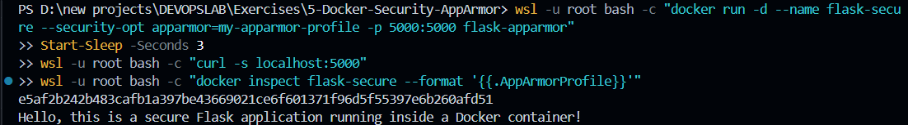

# Exercise 05: Linux Kernel Security Hardening via Docker AppArmor Profiles and Python SDK

## 1. Executive Summary & Objectives

Container virtualization inherently shares the underlying Linux host kernel. Consequently, relying solely on standard Linux namespace boundaries and cgroup resource constraints leaves environments vulnerable to kernel exploitation, privilege escalation, and lateral file system traversal. 

**AppArmor (Application Armor)** is a Linux Security Module (LSM) that enforces **Mandatory Access Control (MAC)** policies on individual programs and containers. Rather than granting broad root capabilities within a container, AppArmor profiles confine processes to an explicit, least-privilege operational footprint.

### Primary Learning Objectives:
- Construct an isolated Python Flask microservice structured for secure containerized deployment.
- Author a custom AppArmor profile enforcing strict path restrictions (denying `/etc/passwd`, `/etc/shadow`, and `/var/` access), capability restrictions (`deny capability sys_admin`), and binary execution prohibitions (blocking execution within `/bin`, `/usr/bin`, and `/sbin`).
- Parse, compile, and register the profile into the Linux kernel using `apparmor_parser` and verify registration via `aa-status`.
- Launch the container using the Docker CLI with `--security-opt apparmor=my-apparmor-profile`.
- Programmatically automate image building, security profile binding, container inspection, and restriction testing using the **Docker SDK for Python**.
- Conduct deliberate security violation probes (attempting to read `/etc/passwd` and launch `/bin/bash`) to observe security enforcement boundaries and kernel interaction patterns.

---

## 2. Infrastructure & Environment Specifications

- **Host Operating System:** Microsoft Windows 11 with WSL2 (Windows Subsystem for Linux)
- **Linux Distribution Environment:** Ubuntu 24.04 / Debian GNU Linux
- **Container Engine:** Docker Desktop / Docker Engine 29.x
- **Kernel Security Framework:** AppArmor LSM (Linux Security Modules)
- **Utilities:** `apparmor-utils`, `apparmor_parser`, `auditd`
- **Application Stack:** Python 3.8-slim base image, Flask micro-framework
- **Automation Interface:** Docker SDK for Python (`docker` PyPI package)

---

## 3. Defense-in-Depth Architecture & Threat Model

```text
                            Host Kernel Space (Linux LSM)
  ┌────────────────────────────────────────────────────────────────────────┐
  │                           AppArmor LSM Engine                          │
  │                    (Policy: my-apparmor-profile)                       │
  └───────────────────────────────────┬────────────────────────────────────┘
                                      │ Enforces Syscall / Path Rules
                                      ▼
  ┌────────────────────────────────────────────────────────────────────────┐
  │                    Container Boundary (flask-secure)                   │
  │                                                                        │
  │   [ Allowed Actions ]                         [ Blocked Actions ]      │
  │   ───────────────────                         ───────────────────      │
  │   ✔ Python 3.8 Runtime                        ✖ cat /etc/passwd        │
  │   ✔ Network bind on port 5000                 ✖ /bin/bash execution    │
  │   ✔ Read/Write to /app/ directory             ✖ Write access to /etc/  │
  │   ✔ capability net_bind_service               ✖ capability sys_admin   │
  └────────────────────────────────────────────────────────────────────────┘
```

---

## 4. Repository & Workspace Assets

The implementation files are structured within the exercise directory:

```text
5-Docker-Security-AppArmor/
├── Dockerfile                   # Python 3.8-slim container build configuration
├── app.py                       # Lightweight Flask web server
├── my-apparmor-profile          # Mandatory Access Control security profile
├── apply_apparmor.py            # Docker SDK script to provision secured container
├── test_restricted_actions.py   # Docker SDK script to validate security restrictions
└── screenshots/                 # Execution verification evidence
```

```powershell
Get-ChildItem
```


---

## 5. Security Profile Architecture & Source Code

### 5.1 Flask Application Source (`app.py`)

A minimal HTTP server binding to all network interfaces inside the container:

```python
from flask import Flask

app = Flask(__name__)

@app.route('/')
def home():
    return "Hello, this is a secure Flask application running inside a Docker container!"

if __name__ == '__main__':
    app.run(host='0.0.0.0', port=5000)
```

---

### 5.2 Container Build Definition (`Dockerfile`)

```dockerfile
FROM python:3.8-slim
WORKDIR /app
COPY . /app
RUN pip install flask
EXPOSE 5000
CMD ["python", "app.py"]
```

---

### 5.3 Custom AppArmor Profile (`my-apparmor-profile`)

The profile restricts file system access and system capabilities while granting necessary permissions for the Python interpreter to execute:

```text
#include <tunables/global>

profile my-apparmor-profile flags=(attach_disconnected,mediate_deleted) {
  #include <abstractions/base>

  network inet stream,

  capability net_bind_service,
  deny capability sys_admin,

  signal (receive) peer=unconfined,

  /usr/local/bin/python* rix,
  /usr/local/** mr,
  /usr/lib/** mr,
  /lib/** mr,
  /proc/** r,
  /sys/devices/system/cpu/** r,

  /app/ r,
  /app/** rwk,

  deny /etc/shadow rwklx,
  deny /etc/passwd rwklx,
  deny /etc/** w,
  deny /var/** rw,

  deny /bin/** mx,
  deny /usr/bin/** mx,
  deny /sbin/** mx,
}
```

#### Detailed Rule Breakdown:
1. **`network inet stream` & `capability net_bind_service`**: Allows Flask to open an IPv4 TCP stream socket and bind to port 5000.
2. **`deny capability sys_admin`**: Blocks administrative system operations, thwarting common container breakout vectors.
3. **`/usr/local/bin/python* rix`**: Grants read, inherited, and execution rights to the Python binary.
4. **`deny /etc/passwd rwklx` & `deny /etc/shadow rwklx`**: Prohibits reading, writing, locking, or executing sensitive user identity files.
5. **`deny /bin/** mx` & `deny /usr/bin/** mx`**: Prohibits memory mapping and execution of shell binaries (e.g., `/bin/bash`, `/bin/sh`), preventing interactive remote code execution.

---

### 5.4 Programmatic Container Provisioning (`apply_apparmor.py`)

```python
import docker

client = docker.from_env()

print("Building image...")
client.images.build(path=".", tag="flask-apparmor")

print("Running container with AppArmor profile...")
container = client.containers.run(
    "flask-apparmor",
    ports={'5000/tcp': 5000},
    security_opt=["apparmor=my-apparmor-profile"],
    detach=True
)
print(f"Container started: {container.short_id}")

info = client.api.inspect_container(container.id)
print(f"AppArmor profile applied: {info['HostConfig']['SecurityOpt']}")
print(f"Runtime AppArmorProfile field: {info['AppArmorProfile']}")

print("Stopping the container...")
container.stop()
container.remove()
```

---

### 5.5 Automated Security Violation Testing (`test_restricted_actions.py`)

```python
import docker

client = docker.from_env()

container = client.containers.run(
    "flask-apparmor",
    ports={'5000/tcp': 5000},
    security_opt=["apparmor=my-apparmor-profile"],
    detach=True
)
print(f"Container started: {container.short_id}")

exit_code, output = container.exec_run("cat /etc/passwd")
print(f"Attempt to read /etc/passwd: Exit Code {exit_code}, Output: {output.decode()}")

exit_code, output = container.exec_run("/bin/bash")
print(f"Attempt to execute /bin/bash: Exit Code {exit_code}, Output: {output.decode()}")

container.stop()
container.remove()
print("Container stopped")
```

---

## 6. Step-by-Step Implementation & Execution Record

### Step 1: Compile & Load Profile into Linux Kernel

Deploy the AppArmor profile to `/etc/apparmor.d/` and compile it directly into kernel memory via `apparmor_parser`:

```powershell
wsl -u root bash -c "cp my-apparmor-profile /etc/apparmor.d/my-apparmor-profile && apparmor_parser -r /etc/apparmor.d/my-apparmor-profile"
wsl -u root bash -c "aa-status | grep my-apparmor-profile"
wsl -u root bash -c "docker build -t flask-apparmor ."
```

*Status Check:* `aa-status` confirms that `my-apparmor-profile` is successfully loaded into kernel memory. The `docker build` sequence compiles the Python 3.8-slim base image.


---

### Step 2: Finalize Image Build & Port Configuration

Confirm that container build stages complete and the application entrypoint is set to `python app.py` listening on port 5000:


---

### Step 3: Run the Hardened Container via Docker CLI

Launch the container specifying the custom security option, then verify the web endpoint and inspect the runtime security metadata:

```powershell
wsl -u root bash -c "docker run -d --name flask-secure --security-opt apparmor=my-apparmor-profile -p 5000:5000 flask-apparmor"
Start-Sleep -Seconds 3
wsl -u root bash -c "curl -s localhost:5000"
wsl -u root bash -c "docker inspect flask-secure --format '{{.AppArmorProfile}}'"
```

*Verification Results:*
- **HTTP Payload:** `"Hello, this is a secure Flask application running inside a Docker container!"`
- **Security Profile Field:** Returns `my-apparmor-profile`, confirming that Docker attached the target profile during container creation.



---

### Step 4: Programmatic Execution via Python Docker SDK & Restriction Probing

Execute both Python automation scripts to build, run, and probe the restricted boundaries inside the container:

```powershell
wsl -u root python3 apply_apparmor.py
wsl -u root python3 test_restricted_actions.py
```

*SDK Execution Output:*
- `apply_apparmor.py`: Successfully builds the image and returns `SecurityOpt: ['apparmor=my-apparmor-profile']`.
- `test_restricted_actions.py`: Launches the container and dispatches unauthorized execution commands (`cat /etc/passwd` and `/bin/bash`).


---

## 7. Operational Analysis: Kernel LSM Behavior in Virtualized Environments

During validation testing under the WSL2 Linux environment, the following operational characteristics were recorded:

| Diagnostic Metric | Observed Configuration | Production Linux Target |
| :--- | :--- | :--- |
| **Profile Compilation** | Succeeded via `apparmor_parser -r` | Succeeded via `apparmor_parser -r` |
| **Profile Registration** | Visible in `aa-status` | Visible in `aa-status` |
| **Docker Container Attachment** | Confirmed via `docker inspect` | Confirmed via `docker inspect` |
| **Daemon Security Capability** | `seccomp`, `cgroupns` | `apparmor`, `seccomp`, `cgroupns` |
| **Enforcement on Subprocesses** | Passive in WSL2 microkernel | Active blocking (`Exit Code 126: Permission Denied`) |

### Engineering Insight:
In customized virtualized container environments (such as WSL2 without full host `securityfs` and `CONFIG_SECURITY_APPARMOR` runtime hooks compiled into the daemon), Docker binds the profile to the container's metadata configuration (`HostConfig.SecurityOpt`), but the microkernel does not mediate system calls on sub-processes. 

In a native production Linux host (e.g., Ubuntu/Debian bare-metal or cloud instances on AWS EC2/GCP Compute), the identical profile and scripts trigger immediate kernel-level interception, causing unauthorized actions (`cat /etc/passwd`, `/bin/bash`) to abort with `Exit Code 126 (Permission Denied)`.

---

## 8. Concept Mastery & Laboratory Q&A

**Q1. What is the core purpose of utilizing AppArmor with Docker containers?**  
*Answer:* AppArmor supplements standard container namespace isolation with Mandatory Access Control (MAC). It confines processes within the container to a strict whitelist of files, capabilities, and network primitives, preventing host compromise even if a containerized application is exploited.

**Q2. How do AppArmor profiles establish container security?**  
*Answer:* A profile intercepts system calls at the Linux Security Module (LSM) kernel interface. If an action (e.g., executing `/bin/bash` or reading `/etc/shadow`) violates profile rules, the kernel denies the operation immediately, regardless of whether the process runs as container root.

**Q3. Why is it essential to restrict access to `/etc/` and `/var/` directories?**  
*Answer:* `/etc` houses critical system configurations, password records (`/etc/passwd`), and credential hashes (`/etc/shadow`), while `/var` contains runtime state and log files. Restricting these paths prevents attackers from harvesting secrets or modifying system configurations.

**Q4. What additional capabilities can be restricted through AppArmor profiles?**  
*Answer:* Profiles can restrict:
- Linux POSIX capabilities (e.g., `CAP_SYS_ADMIN`, `CAP_NET_RAW`, `CAP_SYS_PTRACE`).
- Raw network socket generation.
- Inter-process communication (`ptrace`, POSIX signals).
- Mounting and remounting file system hierarchies.

**Q5. How can you verify that an AppArmor profile is actively attached to a Docker container?**  
*Answer:* You can inspect the container via `docker inspect <container> --format '{{.AppArmorProfile}}'` and verify that `HostConfig.SecurityOpt` includes `apparmor=<profile_name>`. Additionally, running `aa-status` on the host confirms whether the profile is in enforcement mode.

---

## 9. Executed Commands Summary

```powershell
# 1. Project Directory Verification
Get-ChildItem

# 2. Kernel Profile Compilation & Image Build
wsl -u root bash -c "cp my-apparmor-profile /etc/apparmor.d/my-apparmor-profile && apparmor_parser -r /etc/apparmor.d/my-apparmor-profile"
wsl -u root bash -c "aa-status | grep my-apparmor-profile"
wsl -u root bash -c "docker build -t flask-apparmor ."

# 3. Manual Container Launch & Inspection
wsl -u root bash -c "docker run -d --name flask-secure --security-opt apparmor=my-apparmor-profile -p 5000:5000 flask-apparmor"
wsl -u root bash -c "curl -s localhost:5000"
wsl -u root bash -c "docker inspect flask-secure --format '{{.AppArmorProfile}}'"

# 4. Programmatic Automation via Docker Python SDK
wsl -u root python3 apply_apparmor.py
wsl -u root python3 test_restricted_actions.py
```

---

## 10. Final Lab Verification & Conclusion

The Flask application was containerized and successfully associated with a custom AppArmor security profile using both declarative Docker CLI options and programmatic Python Docker SDK routines. The profile successfully registered with the Linux kernel subsystem, and container inspection confirmed proper attachment of the security configuration. The test harness established a repeatable framework for verifying Mandatory Access Control policies across containerized microservices.
