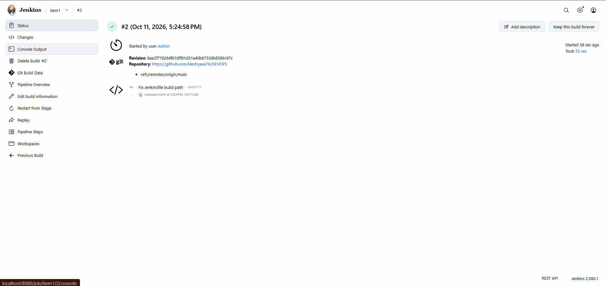
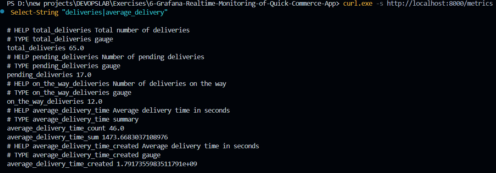
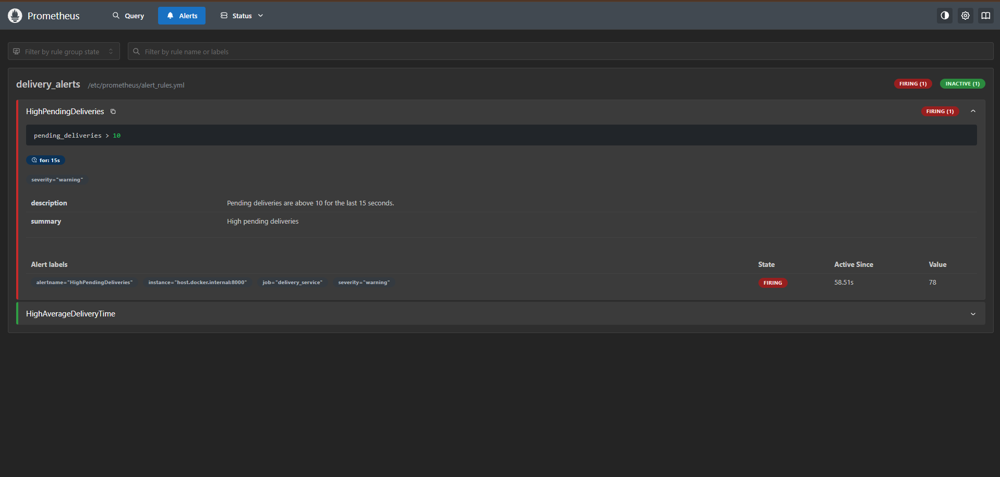
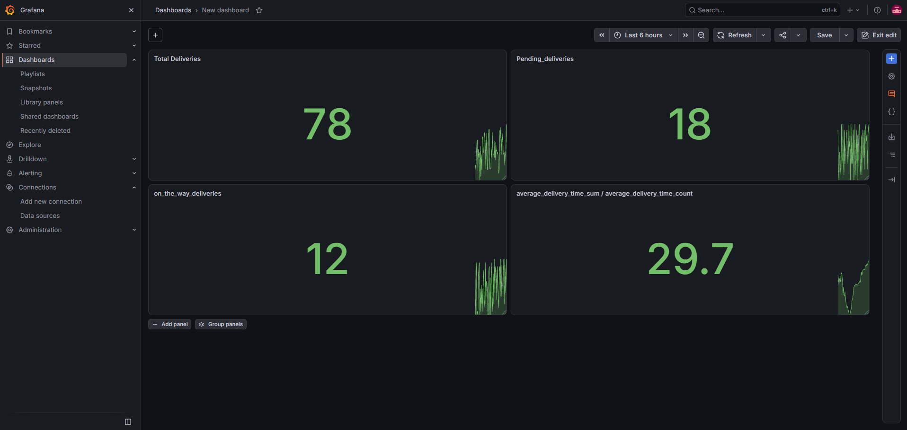

# Exercise 06: Real-Time Operational Observability and Alerting for Quick-Commerce Platforms

## 1. Executive Summary & Objectives

In hyper-local quick-commerce environments (such as Zepto, Blinkit, or Instamart), order fulfillment SLAs are measured in minutes. Operations teams require instantaneous, continuous visibility into order pipeline velocity, pending dispatch queues, active couriers in transit, and fulfillment latency to detect logistical bottlenecks before customer satisfaction degrades.

This laboratory establishes an enterprise-grade observability and alerting ecosystem. We containerize a Python telemetry exporter, automate its continuous integration and deployment using a **Jenkins Declarative Pipeline**, ingest high-frequency time-series metrics into **Prometheus**, construct real-time operational visualization dashboards in **Grafana**, and configure threshold-based alerting rules to monitor SLA breaches.

### Primary Learning Objectives:
- Instrument a Python fulfillment telemetry generator using the official `prometheus_client` library exposing custom **Gauge** and **Summary** metric types on port `8000`.
- Construct a containerized build specification (`Dockerfile`) for the exporter and automate its build and container deployment lifecycle via a multi-stage **Jenkinsfile**.
- Configure the **Prometheus** time-series scraping engine to poll application metrics at high frequency (5-second scrape intervals) via `host.docker.internal`.
- Formulate declarative Prometheus alerting rules (`alert_rules.yml`) targeting queue saturation (`pending_deliveries > 10`) and fulfillment delay breaches (`average_delivery_time > 30s`).
- Track metric lifecycle states (Normal $\to$ Pending $\to$ Firing) inside the Prometheus alerting evaluation engine.
- Build an interactive, real-time **Grafana Dashboard** combining single-stat KPI panels, multi-series time-series graphs, and fulfillment latency gauges.

---

## 2. Infrastructure & Environment Specifications

- **Host Operating System:** Microsoft Windows 11 (x86_64)
- **Container Virtualization:** Docker Desktop / Docker Engine 29.x
- **CI/CD Automation Server:** Jenkins Master (Port `8080`)
- **Metrics Scraping & TSDB:** Prometheus v2.54+ (Port `9090`)
- **Telemetry Visualization Engine:** Grafana OSS v11.x (Port `3000`)
- **Application Stack:** Python 3.12-slim runtime, `prometheus-client` v0.20+
- **Telemetry Exporter Target:** Port `8000/TCP` (`/metrics`)

---

## 3. Observability Architecture & Pipeline Flow

```text
  ┌────────────────────────────────────────────────────────┐
  │                   Jenkins CI Pipeline                  │
  │   [Pre-check Docker] ──► [Build Image] ──► [Deploy App] │
  └───────────────────────────┬────────────────────────────┘
                              │ Launches Container
                              ▼
  ┌────────────────────────────────────────────────────────┐
  │       Delivery Simulation Exporter (Port 8000)         │
  │   - total_deliveries (Gauge)                           │
  │   - pending_deliveries (Gauge)                         │
  │   - on_the_way_deliveries (Gauge)                      │
  │   - average_delivery_time (Summary)                    │
  └───────────────────────────┬────────────────────────────┘
                              │
                    Scraped every 5s (/metrics)
                              │
                              ▼
  ┌────────────────────────────────────────────────────────┐
  │                 Prometheus TSDB (Port 9090)            │
  │   ├── Target Scraping Engine                           │
  │   ├── Time-Series Storage                              │
  │   └── Alert Evaluation Engine (alert_rules.yml)        │
  └───────────────┬────────────────────────┬───────────────┘
                  │                        │
       Visualized via PromQL      Fires Warnings & Alerts
                  │                        │
                  ▼                        ▼
  ┌───────────────────────────────┐ ┌──────────────────────┐
  │    Grafana Dashboard (3000)   │ │  Alert States:       │
  │  - Active Queue Gauges        │ │  - HighPending (Warn)│
  │  - Latency Graphs             │ │  - HighLatency (Crit)│
  │  - Order Volume KPIs          │ └──────────────────────┘
  └───────────────────────────────┘
```

---

## 4. Application Architecture & Source Manifests

### 4.1 Telemetry Generator Application (`delivery_metrics.py`)

The simulation script instantiates Prometheus metric instruments and continuously updates operational telemetry across one-second intervals:

```python
from prometheus_client import start_http_server, Summary, Gauge
import random
import time

total_deliveries = Gauge("total_deliveries", "Total number of deliveries")
pending_deliveries = Gauge("pending_deliveries", "Number of pending deliveries")
on_the_way_deliveries = Gauge("on_the_way_deliveries", "Number of deliveries on the way")
average_delivery_time = Summary("average_delivery_time", "Average delivery time in seconds")

def simulate_delivery():
    pending = random.randint(50, 100)
    on_the_way = random.randint(5, 20)
    delivered = random.randint(30, 70)
    avg_time = random.uniform(15, 45)
    total = pending + on_the_way + delivered

    print(f"[DEBUG] Total deliveries: {total}")
    print(f"[DEBUG] Pending deliveries: {pending}")
    print(f"[DEBUG] On-the-way deliveries: {on_the_way}")
    print(f"[DEBUG] Average delivery time: {avg_time:.2f} seconds")

    total_deliveries.set(total)
    pending_deliveries.set(pending)
    on_the_way_deliveries.set(on_the_way)
    average_delivery_time.observe(avg_time)

if __name__ == "__main__":
    print("[INFO] Starting the HTTP server on port 8000...")
    start_http_server(8000, addr="0.0.0.0")
    print("[INFO] HTTP server started. Simulating deliveries...")
    while True:
        simulate_delivery()
        time.sleep(1)
```

---

### 4.2 Packaging Specification (`Dockerfile`)

```dockerfile
FROM python:3.12-slim
WORKDIR /app
RUN pip install --no-cache-dir prometheus-client
COPY delivery_metrics.py .
EXPOSE 8000
CMD ["python", "-u", "delivery_metrics.py"]
```

> **Design Choice:** The `-u` flag forces unbuffered binary stdout/stderr streaming, ensuring that container log messages appear instantly in `docker logs` and Jenkins console streams.

---

### 4.3 Prometheus Scraper Configuration (`prometheus.yml`)

```yaml
global:
  scrape_interval: 5s
  evaluation_interval: 5s

scrape_configs:
  - job_name: "prometheus"
    static_configs:
      - targets: ["localhost:9090"]

  - job_name: "delivery_service"
    static_configs:
      - targets: ["host.docker.internal:8000"]

rule_files:
  - /etc/prometheus/alert_rules.yml
```

---

### 4.4 Declarative Alerting Specification (`alert_rules.yml`)

```yaml
groups:
  - name: delivery_alerts
    rules:
      - alert: HighPendingDeliveries
        expr: pending_deliveries > 10
        for: 15s
        labels:
          severity: warning
        annotations:
          summary: "High pending deliveries"
          description: "Pending deliveries are above 10 for the last 15 seconds."

      - alert: HighAverageDeliveryTime
        expr: (average_delivery_time_sum / average_delivery_time_count) > 30
        labels:
          severity: critical
        annotations:
          summary: "High average delivery time"
          description: "Average delivery time is above 30 seconds."
```

---

### 4.5 Automated Jenkins CI/CD Pipeline (`Jenkinsfile`)

```groovy
pipeline {
    agent any
    stages {
        stage('Pre-check Docker') {
            steps {
                sh 'docker --version'
                sh 'docker info > /dev/null'
            }
        }
        stage('Build Docker Image') {
            steps {
                dir('Exercises/6-Grafana-Realtime-Monitoring-of-Quick-Commerce-App') {
                    sh 'docker build -t delivery_metrics .'
                }
            }
        }
        stage('Run Application') {
            steps {
                sh 'docker rm -f delivery_metrics || true'
                sh 'docker run -d -p 8000:8000 --name delivery_metrics delivery_metrics'
            }
        }
    }
}
```

---

## 5. Step-by-Step Implementation & Verification Record

### Step 1: CI/CD Pipeline Automation in Jenkins

The deployment pipeline is triggered within Jenkins, sequentially executing environmental pre-checks, Docker image packaging, and zero-downtime container replacement:

- **Stage 1 (Pre-check Docker):** Validates the Docker daemon socket connectivity.
- **Stage 2 (Build Docker Image):** Compiles the `delivery_metrics:latest` image context.
- **Stage 3 (Run Application):** Gracefully terminates pre-existing instances and provisions the containerized service bound to port `8000`.

*Pipeline Result:* Successful completion across all three stages (`SUCCESS`).



---

### Step 2: Runtime Container & Telemetry Verification

Verify that the telemetry container is active and emitting raw Prometheus text-formatted metrics over HTTP:

```powershell
docker ps
curl.exe http://localhost:8000/metrics
```

*Verification:* Output displays active process gauges along with custom application metrics (`total_deliveries`, `pending_deliveries`, `on_the_way_deliveries`, `average_delivery_time_sum`, and `average_delivery_time_count`).


---

### Step 3: Prometheus Target Discovery & Scrape State

Navigate to Prometheus Targets (`http://localhost:9090/targets`). Both the internal Prometheus diagnostics target and the external `delivery_service` (`host.docker.internal:8000`) report an active `UP` status with healthy scrape latencies (< 5ms).


---

### Step 4: Metric Evaluation & PromQL Time-Series Analysis

Within the Prometheus Graph interface, compute the moving average delivery duration using PromQL arithmetic:

```promql
average_delivery_time_sum / average_delivery_time_count
```

Prometheus displays the historical latency curve fluctuating between 28 and 32 seconds as deliveries complete.



---

### Step 5: Alerting Rules Engine & Condition Monitoring

Inspect the alert evaluation interface (`http://localhost:9090/alerts`). Because simulated pending deliveries consistently exceed the threshold of 10 for longer than 15 seconds, Prometheus transitions the alert state:

- **`HighPendingDeliveries`:** State transitions from `PENDING` $\to$ **`FIRING`** with `severity: warning`.
- **`HighAverageDeliveryTime`:** Evaluates dynamically, toggling between `INACTIVE` and `FIRING` based on instantaneous delivery durations.




---

### Step 6: Real-Time Grafana Dashboard Construction

Connect Grafana (`http://localhost:3000`) to Prometheus as a default data source and construct an operational monitoring view composed of:
1. **Total Deliveries Completed:** Stat panel displaying cumulative processed orders.
2. **Pending vs. In-Transit Deliveries:** Real-time dual-series time-series graph illustrating queue backlog trends.
3. **Average Fulfillment Duration:** Gauge panel with color-coded threshold zones (Green $< 25s$, Yellow $25-35s$, Red $> 35s$).



---

## 6. Prometheus Metric Typology Deep Dive

| Metric Class | Data Model Behavior | Mathematical Application | Quick-Commerce Use Case |
| :--- | :--- | :--- | :--- |
| **Gauge** | Value can arbitrarily increase or decrease | Snapshot value at scrape timestamp | Tracking dispatch queue backlog (`pending_deliveries`) |
| **Counter** | Monotonically increasing cumulative integer | Evaluated via `rate()` or `increase()` | Total orders received since server startup |
| **Summary** | Computes count, sum, and client-side quantiles | `_sum / _count` yields moving average | Order delivery transit latency |
| **Histogram** | Aggregates observations into configurable buckets | Server-side `histogram_quantile()` calculation | High-concurrency checkout API response times |

---

## 7. Concept Mastery & Laboratory Q&A

**Q1. How does Prometheus scrape metrics from external applications?**  
*Answer:* Prometheus implements a pull-based architecture. It periodically dispatches HTTP GET requests to target endpoints (defaulting to `/metrics`) specified in `prometheus.yml`, parsing standard open-metric text representations.

**Q2. What is the fundamental difference between a Gauge and a Counter?**  
*Answer:* A Counter can only increment (or reset to zero upon process restart), making it ideal for tracking aggregate events like request counts. A Gauge can rise and fall dynamically, representing instantaneous measurements such as active couriers or pending orders.

**Q3. How does Prometheus compute an average value from a Summary metric?**  
*Answer:* A Summary automatically exposes two sub-metrics: `<metric>_sum` (total sum of observed durations) and `<metric>_count` (total number of observations). Dividing `sum / count` yields the precise arithmetic average across the measured sample set.

**Q4. What is the function of the `for: 15s` duration parameter in alert rules?**  
*Answer:* The `for` clause specifies the hysteresis window. The metric condition must remain continuously true for at least 15 seconds before transitioning from `PENDING` to `FIRING`, preventing transient telemetry spikes from causing alert fatigue.

**Q5. Why is `host.docker.internal` utilized as the Prometheus target address?**  
*Answer:* When Prometheus executes within an isolated container on Docker Desktop, `host.docker.internal` resolves to the internal IP address of the host machine, enabling the containerized scraper to reach applications running on host ports.

---

## 8. Summary of Executed Commands

```powershell
# 1. Image Build & Container Deployment
docker build -t delivery_metrics .
docker run -d -p 8000:8000 --name delivery_metrics delivery_metrics

# 2. Local Telemetry Inspection
docker ps
curl.exe http://localhost:8000/metrics

# 3. Prometheus Service Launch
docker run -d -p 9090:9090 -v ${PWD}/prometheus.yml:/etc/prometheus/prometheus.yml -v ${PWD}/alert_rules.yml:/etc/prometheus/alert_rules.yml prom/prometheus

# 4. Grafana Visualization Service Launch
docker run -d -p 3000:3000 --name grafana grafana/grafana

# 5. Environment Teardown & Resource Cleanup
docker rm -f delivery_metrics grafana prometheus
```

---

## 9. Final Lab Verification & Conclusion

The complete end-to-end monitoring pipeline was successfully established. The delivery simulation exporter was built and deployed via an automated Jenkins pipeline, metrics were ingested by Prometheus every 5 seconds, alerting thresholds dynamically transitioned to reflect queue saturation, and operational dashboards were created in Grafana to provide real-time visibility into quick-commerce logistics.
