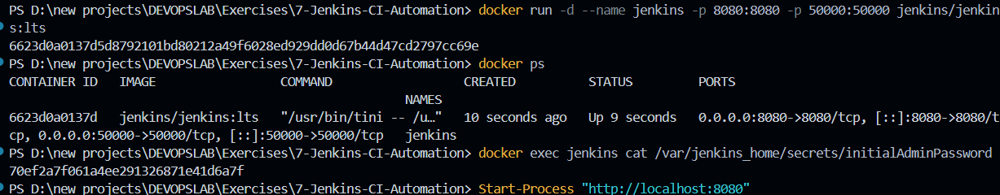
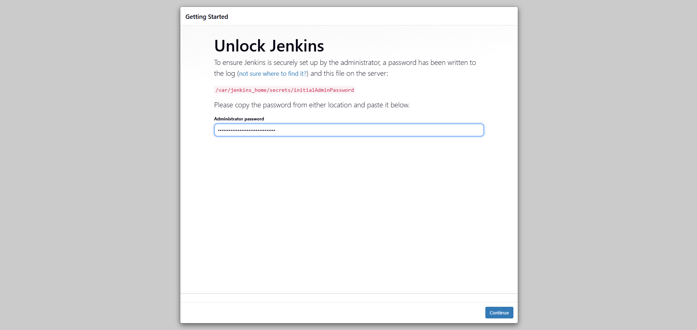

# Exercise 07: Automated Continuous Integration (CI) and Containerized Jenkins Server Deployment

## 1. Executive Summary & Objectives

Continuous Integration (CI) is a core DevOps engineering discipline where developers merge code modifications into a central shared repository multiple times daily. Each code integration triggers an autonomous, verifiable build and automated test suite. This rapid feedback loop detects regression defects, dependency mismatches, and syntax errors within minutes of introduction, substantially lowering remediation costs.

**Jenkins** is the industry-standard, extensible open-source automation server supporting Continuous Integration and Continuous Delivery (CI/CD). 

### Primary Learning Objectives:
- Evaluate the theoretical framework of Continuous Integration, comparing industry platforms (Jenkins, GitLab CI, GitHub Actions, Azure Pipelines, CircleCI).
- Deploy an isolated, containerized Jenkins Master instance using the official `jenkins/jenkins:lts` container image.
- Map and manage dual-layer network ports: Port `8080` (HTTP Web User Interface) and Port `50000` (Inbound Agent JNLP communication).
- Extract cryptographic setup credentials from the container's persistent storage volume (`/var/jenkins_home/secrets/initialAdminPassword`).
- Execute the initial setup wizard, configure standard plugin architectures, and establish operational access to the primary Jenkins administrative console.
- Analyze the internal CI feedback loop and the distributed Controller-Agent execution topology.

---

## 2. Infrastructure & Environment Specifications

- **Host Operating System:** Microsoft Windows 11 (x86_64)
- **Containerization Runtime:** Docker Desktop / Docker Engine 29.x
- **CLI Shell Environment:** PowerShell / VS Code Terminal
- **Base Image:** `jenkins/jenkins:lts` (Long-Term Support baseline)
- **Jenkins Runtime Version:** v2.580.1
- **Management Port:** `8080/TCP` (Web UI & REST API)
- **Agent Tunneling Port:** `50000/TCP` (Java Network Launch Protocol - JNLP)

---

## 3. Comparative Matrix of Modern CI/CD Platforms

| CI/CD Platform | Architecture Model | Configuration Syntax | Primary Enterprise Strengths |
| :--- | :--- | :--- | :--- |
| **Jenkins** | Self-hosted Controller / Distributed Agents | Declarative & Scripted Groovy (`Jenkinsfile`) | Infinite extensibility (1,800+ plugins), zero licensing fees, full on-premises control |
| **GitHub Actions** | Managed SaaS + Self-hosted Runners | YAML (`.github/workflows/*.yml`) | Native GitHub integration, marketplace reusability, matrix workflows |
| **GitLab CI/CD** | Unified Single-Application DevOps | YAML (`.gitlab-ci.yml`) | Deep repository coupling, Auto-DevOps, built-in container registry |
| **CircleCI** | Cloud-native + Containerized runners | YAML (`.circleci/config.yml`) | Fast build parallelization, resource caching, optimized Docker support |
| **Azure Pipelines** | Multi-platform Hybrid Enterprise | YAML or Classic Visual UI | Seamless integration with Microsoft ecosystem and Azure Kubernetes Service |

---

## 4. Architectural Topology: Controller & Agent Model

```text
               [ Developer Terminal ]
                         │
                 git push origin main
                         │
                         ▼
               [ Git Source Control ]
                         │
                  Webhook / Poll SCM
                         │
                         ▼
        ┌───────────────────────────────────┐
        │     Jenkins Master Controller     │
        │    (Container Port: 8080/HTTP)    │
        │                                   │
        │  ├── Job Scheduling Engine        │
        │  ├── Plugin Management System     │
        │  └── Build Queue & History        │
        └─────────────────┬─────────────────┘
                          │
         JNLP Remoting (Port: 50000)
                          │
          ┌───────────────┴───────────────┐
          ▼                               ▼
┌───────────────────┐           ┌───────────────────┐
│ Execution Node 1  │           │ Execution Node 2  │
│ (Build & Compile) │           │ (Unit Test Suite) │
└───────────────────┘           └───────────────────┘
```

---

## 5. Step-by-Step Implementation & Execution Record

### Step 1: Provision Containerized Jenkins Controller

Instantiate the official Jenkins Long Term Support (LTS) container in background detached mode, binding host ports 8080 and 50000:

```powershell
docker run -d --name jenkins -p 8080:8080 -p 50000:50000 jenkins/jenkins:lts
```

*Execution Mechanics:* Docker queries local storage, pulls intermediate container layers from Docker Hub, initializes the OpenJDK runtime, generates cryptographic SSH/TLS host keys, and launches the Jenkins daemon.

---

### Step 2: Validate Container Lifecycle & Port Publishing

Confirm that the container runtime transitioned the process into an active `Up` state:

```powershell
docker ps
```

*Process Table:* Confirms `jenkins/jenkins:lts` is running with port mappings `0.0.0.0:8080->8080/tcp` and `0.0.0.0:50000->50000/tcp`.

---

### Step 3: Extract Bootstrap Administrative Password

During the first boot sequence, Jenkins writes an alphanumeric administrative secret to protect against unauthorized installation tampering. Retrieve this secret directly from the container's file system:

```powershell
docker exec jenkins cat /var/jenkins_home/secrets/initialAdminPassword
```

*Credential Output:* Emits the 32-character hexadecimal authorization token.



---

### Step 4: Access Web Console & Execute Administrative Unlock

Launch the browser and navigate to the local management endpoint:

```powershell
Start-Process "http://localhost:8080"
```

The browser renders the **Unlock Jenkins** security gate. Input the retrieved token into the **Administrator password** field and select **Continue**.



---

### Step 5: Finalize Setup & Initialize System Workspace

Proceed through the initialization wizard. The system initializes core modules, configures the administrative context, and confirms readiness:

The **Jenkins is ready!** confirmation banner displays, validating that all backend pipelines, storage provisioners, and thread executors are online. Click **Start using Jenkins**.


---

### Step 6: Inspect Primary Jenkins Operational Dashboard

Upon authentication, the browser routes to the main administrative portal:

*Dashboard Structural Components:*
- **Left Navigation Panel:** Access to `New Item` (job creation), `People`, `Build History`, and `Manage Jenkins` (system configuration).
- **Execution Monitors:** Displays the active `Build Queue` and two default concurrent worker executor threads (`Build Executor Status: 0/2 idle`).
- **Engine Version:** Confirms active deployment of Jenkins core `v2.580.1`.


---

## 6. The Continuous Integration Feedback Loop

The automated verification sequence established by Jenkins operates across five cyclical stages:

```text
  [ 1. Commit ]   ──► Developer pushes code changes to shared repository.
        │
  [ 2. Trigger ]  ──► SCM webhook or periodic poll triggers Jenkins pipeline.
        │
  [ 3. Compile ]  ──► Workspace pulls context, resolves dependencies, and compiles binaries.
        │
  [ 4. Test ]     ──► Test harness executes unit, regression, and integration tests.
        │
  [ 5. Notify ]   ──► Status metrics (Success/Failure) dispatched to commit logs and team channels.
```

---

## 7. Concept Mastery & Laboratory Q&A

**Q1. What is the fundamental objective of Continuous Integration?**  
*Answer:* To merge developer working copies to a shared mainline continuously, automatically validating each submission with builds and tests to identify and eliminate integration defects early in the lifecycle.

**Q2. Why does the Jenkins container require mapping two separate ports (8080 and 50000)?**  
*Answer:* Port `8080` serves the HTTP graphical interface and REST API consumed by human users and webhooks. Port `50000` is dedicated to the inbound Java Network Launch Protocol (JNLP) daemon, allowing remote build agents to communicate with the master controller.

**Q3. Where is the initial administrator unlock credential located inside the container?**  
*Answer:* At `/var/jenkins_home/secrets/initialAdminPassword`, accessible via `docker exec`.

**Q4. What is the structural distinction between a Jenkins Controller and a Jenkins Agent?**  
*Answer:* The Controller handles scheduling, web UI rendering, plugin management, and pipeline orchestration. Agents are worker processes (running on distinct VMs, containers, or bare-metal) dedicated solely to executing the actual CPU-intensive build tasks dispatched by the Controller.

**Q5. How do plugins enhance the functionality of a Jenkins installation?**  
*Answer:* Plugins extend the core server with integrations for SCM platforms (GitHub, GitLab, Bitbucket), container runtimes (Docker, Podman), cloud orchestrators (Kubernetes), and artifact repositories (Nexus, Artifactory).

---

## 8. Summary of Executed Commands

```powershell
# 1. Instantiate Containerized Automation Server
docker run -d --name jenkins -p 8080:8080 -p 50000:50000 jenkins/jenkins:lts

# 2. Inspect Container Status
docker ps

# 3. Retrieve Initial Authorization Password
docker exec jenkins cat /var/jenkins_home/secrets/initialAdminPassword

# 4. Launch Browser Interface
Start-Process "http://localhost:8080"

# 5. Environment Teardown (Post-Lab Cleanup)
docker stop jenkins
docker rm jenkins
```

---

## 9. Final Lab Verification & Conclusion

The enterprise Jenkins automation controller was successfully deployed using Docker containerization on Windows 11. Dual port forwarding was validated for management and agent traffic, cryptographic authentication was performed using the internal initial admin password, the setup wizard was completed, and the administrative dashboard was initialized and confirmed operational.
