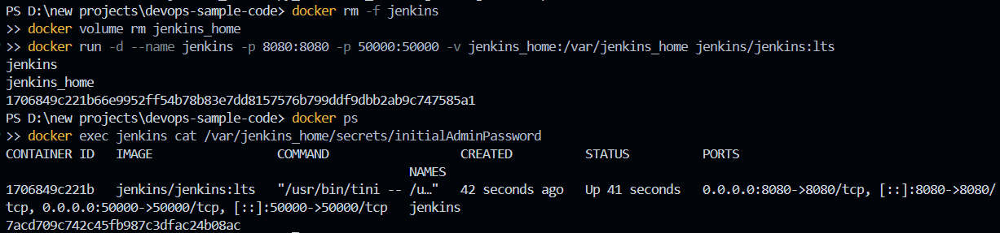
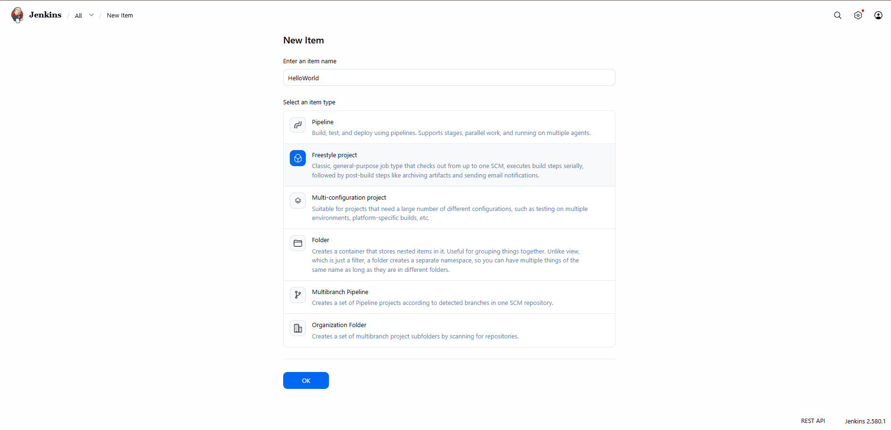

# Exercise 08: Declarative Freestyle Job Automation & Git SCM Integration with Jenkins

## 1. Executive Summary & Objectives

Modern software delivery relies on automated triggers to pull source code from remote Version Control Systems (VCS), allocate isolated workspace environments, compile source artifacts, and execute verification scripts without manual operator intervention.

In Jenkins, a **Freestyle Project** represents the foundational job abstraction designed to execute configurable, sequential build steps—such as shell invocations, batch triggers, and artifact archiving—integrated directly with source code repositories like GitHub.

### Primary Learning Objectives:
- Provision a containerized Jenkins controller backed by a persistent named Docker volume (`jenkins_home`) to preserve job configurations and build histories across container restarts.
- Construct and configure a **Freestyle Project** named `HelloWorld` inside the Jenkins administrative console.
- Establish Source Code Management (SCM) integration, binding the job to a remote GitHub repository containing operational shell scripts (`hello-world.sh`).
- Formulate an automated build step utilizing the **Execute shell** builder.
- Trigger imperative builds (`Build Now`) and inspect real-time log output through the **Console Output** streaming interface.
- Analyze the relationship between process exit codes (`0` vs. non-zero) and Jenkins build status determination (`SUCCESS` vs. `FAILURE`).

---

## 2. Infrastructure & Environment Specifications

- **Host Operating System:** Microsoft Windows 11 (x86_64)
- **Container Runtime:** Docker Desktop / Docker Engine 29.x
- **CI Automation Engine:** Jenkins LTS (`jenkins/jenkins:lts`)
- **Controller Version:** v2.580.1
- **Source Control Management:** Git / GitHub Remote Repository
- **Volume Storage Provider:** Docker Named Volume (`jenkins_home`)
- **Default Shell Interpreter:** `/bin/sh` within Debian container namespace

---

## 3. Automation Architecture & Build Flow

```text
               ┌──────────────────────────────────────────────────┐
               │         Remote GitHub Repository                 │
               │   (devops-sample-code / hello-world.sh)          │
               └────────────────────────┬─────────────────────────┘
                                        │
                               Git Clone / Fetch
                                        │
                                        ▼
               ┌──────────────────────────────────────────────────┐
               │             Jenkins Controller                   │
               │  Job Workspace: /var/jenkins_home/workspace/    │
               │                                                  │
               │  1. Ingests Commit Context                       │
               │  2. Allocates Job Directory: `HelloWorld/`       │
               │  3. Injects Execution Script: `hello-world.sh`   │
               └────────────────────────┬─────────────────────────┘
                                        │
                            Execute Shell Subprocess
                                        │
                                        ▼
               ┌──────────────────────────────────────────────────┐
               │           Console Output & Evaluation            │
               │                                                  │
               │  + sh hello-world.sh                             │
               │  Output: "Hello, Jenkins!"                       │
               │  Process Return Code: 0 ──► Status: SUCCESS      │
               └──────────────────────────────────────────────────┘
```

---

## 4. Script Asset & Source Code Definition

The automated task executes a minimal POSIX-compliant shell script (`hello-world.sh`):

```bash
#!/bin/bash
echo "Hello, Jenkins!"
```

*Execution Contract:* When Jenkins invokes an **Execute shell** build step, it wraps the command into a temporary script within `/tmp`, executes it under `/bin/sh -xe`, and evaluates the resulting exit code. A return code of `0` denotes an uncompromised build, automatically marking the run as **SUCCESS**.

---

## 5. Step-by-Step Implementation & Execution Record

### Step 1: Initialize Jenkins with Named Volume Persistence

Deploy the Jenkins server mounting the named volume `jenkins_home` to ensure workspace files, job metadata, and user accounts survive container recreation:

```powershell
docker rm -f jenkins
docker volume rm jenkins_home
docker run -d --name jenkins -p 8080:8080 -p 50000:50000 -v jenkins_home:/var/jenkins_home jenkins/jenkins:lts
docker ps
docker exec jenkins cat /var/jenkins_home/secrets/initialAdminPassword
```

*Verification:* The container initializes, opens ports `8080` and `50000`, and yields the initial setup secret for authentication at `http://localhost:8080`.



---

### Step 2: Provision a New Freestyle Job

Navigate to the Jenkins dashboard and define a new operational task:
1. Select **New Item** from the top-left navigation drawer.
2. Enter the item identifier: `HelloWorld`.
3. Select **Freestyle project** as the underlying job archetype.
4. Click **OK** to proceed to the job configuration page.



---

### Step 3: Configure Source Control & Build Execution Steps

Within the job configuration interface, configure Git integration and shell execution parameters:

1. **General:**
   - **Description:** `Hello World! Jenkins automated execution job.`
2. **Source Code Management:**
   - Select the **Git** radio button.
   - **Repository URL:** `https://github.com/lakshyaaa76/devops-sample-code.git`
   - **Branch Specifier:** `*/main`
3. **Build Steps:**
   - Select **Add build step** $\to$ **Execute shell**.
   - Input the execution instruction:
     ```bash
     sh hello-world.sh
     ```
4. Click **Save** to persist the configuration.

---

### Step 4: Dispatch Build & Analyze Streaming Console Output

On the job management screen, select **Build Now** to place the task into the execution queue. Click on the initiated run (`#1`) and select **Console Output**:

*Console Stream Log:*
```text
Started by user admin
Running as SYSTEM
Building in workspace /var/jenkins_home/workspace/HelloWorld
The recommended git tool is: NONE(recommended)
Using credential None
 > git rev-parse --resolve-git-dir /var/jenkins_home/workspace/HelloWorld/.git # timeout=10
Fetching changes from the remote Git repository
 > git config remote.origin.url https://github.com/lakshyaaa76/devops-sample-code.git # timeout=10
Fetching upstream changes from https://github.com/lakshyaaa76/devops-sample-code.git
 > git --version # timeout=10
 > git --at-time=1741544810 fetch --tags --force --progress -- https://github.com/lakshyaaa76/devops-sample-code.git +refs/heads/*:refs/remotes/origin/* # timeout=10
 > git rev-parse refs/remotes/origin/main^{commit} # timeout=10
Checking out Revision 66ef70e (refs/remotes/origin/main)
 > git config core.sparsecheckout # timeout=10
 > git checkout -f 66ef70e
Commit message: "Add hello-world.sh"
[HelloWorld] $ /bin/sh -xe /tmp/jenkins841920194819.sh
+ sh hello-world.sh
Hello, Jenkins!
Finished: SUCCESS
```


*Log Diagnostics:*
1. **Workspace Provisioning:** Jenkins allocated `/var/jenkins_home/workspace/HelloWorld`.
2. **SCM Synchronization:** The Git plugin fetched commit `66ef70e` and checked out the `main` branch.
3. **Command Execution:** The shell invoked `sh hello-world.sh`, producing the message `"Hello, Jenkins!"`.
4. **Outcome Evaluation:** Because the script terminated with status code `0`, Jenkins marked the execution as **SUCCESS**.

---

## 6. Freestyle Jobs vs. Pipeline-as-Code

| Characteristic | Freestyle Project | Pipeline (`Jenkinsfile`) |
| :--- | :--- | :--- |
| **Configuration Storage** | XML stored in `jenkins_home` on master | Versioned code in Git repository |
| **Auditability & History** | UI-driven modifications (no Git diffs) | Pull requests and full version tracking |
| **Complex Logic** | Limited to sequential linear steps | Supports conditional stages, loops, parallel branches |
| **Recovery** | Difficult to replicate across clusters | Fully reproducible via pipeline code |

---

## 7. Concept Mastery & Laboratory Q&A

**Q1. What is a Freestyle project in Jenkins?**  
*Answer:* A Freestyle project is a configurable automation job configured through the Jenkins web GUI. It allows operators to chain sequential tasks (SCM checkout, shell executions, compilation commands, and post-build artifact archivers) without writing Groovy pipeline scripts.

**Q2. How does Jenkins synchronize source code from remote Git repositories?**  
*Answer:* Through the Jenkins Git Plugin. When a build is triggered, the plugin queries the remote repository URL, pulls the latest commit from the target branch (e.g., `refs/heads/main`), and writes the files into the job's dedicated local workspace.

**Q3. How does Jenkins determine whether an Execute Shell build step succeeded or failed?**  
*Answer:* Jenkins evaluates the Linux process exit status ($?$). If all commands in the shell block exit with `0`, the step succeeds. If any command emits a non-zero exit code (and `-e` flag is active), execution halts immediately, and the build status transitions to `FAILURE`.

**Q4. Why is mounting `-v jenkins_home:/var/jenkins_home` critical when running Jenkins in Docker?**  
*Answer:* Container filesystems are ephemeral. Mounting a named Docker volume guarantees that job configurations, workspace data, build history records, installed plugins, and credentials persist across container restarts or software upgrades.

---

## 8. Summary of Executed Commands

```powershell
# 1. Start Jenkins with Named Volume
docker rm -f jenkins
docker volume rm jenkins_home
docker run -d --name jenkins -p 8080:8080 -p 50000:50000 -v jenkins_home:/var/jenkins_home jenkins/jenkins:lts

# 2. Status & Authentication Extraction
docker ps
docker exec jenkins cat /var/jenkins_home/secrets/initialAdminPassword

# 3. Environment Teardown (Post-Lab Cleanup)
docker stop jenkins
docker rm jenkins
docker volume rm jenkins_home
```

---

## 9. Final Lab Verification & Conclusion

The Jenkins Freestyle automation workflow was successfully established. The controller pulled code from the remote GitHub repository into an isolated local workspace directory, executed the shell script build step, streamed real-time execution logs, and evaluated the successful termination of the process, concluding with a verified status of `Finished: SUCCESS`.
