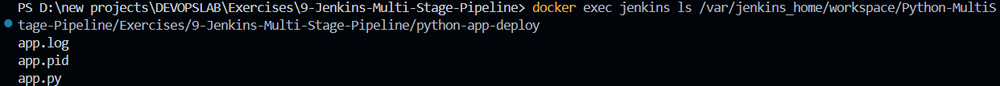

# Exercise 09: Multi-Stage Continuous Delivery Pipelines and Automated Unit Testing with Jenkins

## 1. Executive Summary & Objectives

In modern enterprise DevOps delivery, releasing software requires more than executing a single build script. Robust delivery pipelines implement **progressive quality gates** that partition the deployment lifecycle into isolated, verifiable stages. If any stage—such as dependency compilation, static analysis, or automated unit testing—encounters a failure, the pipeline halts immediately, preventing defective artifacts from polluting downstream environments.

This laboratory focuses on engineering a multi-stage **Declarative Pipeline (`Jenkinsfile`)** that compiles, validates, stages, runs, and smoke-tests a containerized **Python Flask** web microservice.

### Primary Learning Objectives:
- Structure a declarative multi-stage Jenkins pipeline implementing five distinct lifecycle gates: **Build**, **Test**, **Deploy**, **Run Application**, and **Test Application**.
- Author a Python Flask web application alongside an automated unit test suite leveraging Python's native `unittest` framework.
- Configure execution contexts within a monorepo workspace using the `dir("${APP_DIR}")` pipeline directive.
- Provision internal build environment prerequisites (Python 3, Pip, and Flask binaries) directly inside the running Jenkins controller namespace.
- Implement background process daemonization (`nohup` and PID tracking) to simulate production service staging.
- Implement post-execution triggers (`post { success { ... } failure { ... } }`) to automate audit reporting.

---

## 2. Infrastructure & Environment Specifications

- **Host Operating System:** Microsoft Windows 11 (x86_64)
- **Container Virtualization Engine:** Docker Desktop / Docker Engine 29.x
- **CI/CD Platform:** Jenkins LTS (`jenkins/jenkins:lts`)
- **Version Control Provider:** Git / GitHub
- **Application Runtime:** Python 3.11 / Python 3.12, Flask 2.1.2
- **Test Automation Harness:** `unittest` TestRunner
- **Pipeline Paradigm:** Declarative Pipeline-as-Code (`Jenkinsfile`)

---

## 3. Pipeline Flow & Quality Gate Architecture

```text
 ┌────────────────────────────────────────────────────────────────────────┐
 │                      Jenkins Declarative Pipeline                      │
 └───────────────────────────────────┬────────────────────────────────────┘
                                     │
                                     ▼
 ┌─────────────────┐       ┌──────────────────┐       ┌──────────────────┐
 │  Stage 1: Build │ ───►  │  Stage 2: Test   │ ───►  │ Stage 3: Deploy  │
 │  Validate Py3 & │       │ Run unittest on  │       │ Stage artifact to│
 │  Flask Imports  │       │ test_app.py      │       │ python-app-deploy│
 └─────────────────┘       └──────────────────┘       └────────┬─────────┘
                                                               │
                                                               ▼
 ┌─────────────────┐       ┌──────────────────┐       ┌──────────────────┐
 │   Post Actions  │ ◄───  │Stage 5: Test App │ ◄───  │Stage 4: Run App  │
 │  Emit Pipeline  │       │Integration probe │       │Spawn background  │
 │  SUCCESS Status │       │against live app  │       │daemon via nohup  │
 └─────────────────┘       └──────────────────┘       └──────────────────┘
```

---

## 4. Application Architecture & Source Manifests

### 4.1 Microservice Application Source (`app.py`)

```python
from flask import Flask

app = Flask(__name__)

@app.route("/")
def home():
    return "Hello, Jenkins Multi-Stage Pipeline!"

if __name__ == "__main__":
    app.run(debug=True)
```

---

### 4.2 Pinned Dependency Manifest (`requirements.txt`)

```text
flask==2.1.2
```

---

### 4.3 Automated Unit Test Suite (`test_app.py`)

The test suite instantiates Flask's isolated mock client (`app.test_client()`), dispatches an internal HTTP GET request to `/`, and verifies response semantics:

```python
import unittest
from app import app

class TestApp(unittest.TestCase):
    def test_home(self):
        tester = app.test_client()
        response = tester.get("/")
        print(response.data.decode("utf-8"))
        self.assertEqual(response.status_code, 200)
        self.assertEqual(response.data.decode("utf-8"), "Hello, Jenkins Multi-Stage Pipeline!")

if __name__ == "__main__":
    unittest.main()
```

*Assertions Enforced:*
1. **HTTP Status Code:** Validates that the endpoint responds with `200 OK`.
2. **Payload Fidelity:** Asserts that the decoded UTF-8 string precisely matches `"Hello, Jenkins Multi-Stage Pipeline!"`.

---

### 4.4 Multi-Stage Declarative Pipeline (`Jenkinsfile`)

```groovy
pipeline {
    agent any

    environment {
        APP_DIR = 'Exercises/9-Jenkins-Multi-Stage-Pipeline'
    }

    stages {
        stage('Build') {
            steps {
                echo 'Checking Python and dependencies...'
                dir("${APP_DIR}") {
                    sh 'python3 --version'
                    sh 'python3 -c "import flask; print(flask.__version__)"'
                }
            }
        }
        stage('Test') {
            steps {
                echo 'Running tests...'
                dir("${APP_DIR}") {
                    sh 'python3 -m unittest discover -s .'
                }
            }
        }
        stage('Deploy') {
            steps {
                echo 'Deploying application...'
                dir("${APP_DIR}") {
                    sh '''
                    mkdir -p python-app-deploy
                    cp app.py python-app-deploy/
                    '''
                }
            }
        }
        stage('Run Application') {
            steps {
                echo 'Running application...'
                dir("${APP_DIR}") {
                    sh '''
                    nohup python3 python-app-deploy/app.py > python-app-deploy/app.log 2>&1 &
                    echo $! > python-app-deploy/app.pid
                    '''
                }
            }
        }
        stage('Test Application') {
            steps {
                echo 'Testing application...'
                dir("${APP_DIR}") {
                    sh 'python3 test_app.py'
                }
            }
        }
    }

    post {
        success {
            echo 'Pipeline completed successfully!'
        }
        failure {
            echo 'Pipeline failed. Check the logs for more details.'
        }
    }
}
```

---

## 5. Step-by-Step Implementation & Execution Record

### Step 1: Initialize Jenkins with Named Volume Storage

Ensure the containerized automation controller is online and backed by persistent storage:

```powershell
docker run -d --name jenkins -p 8080:8080 -p 50000:50000 -v jenkins_home:/var/jenkins_home jenkins/jenkins:lts
docker exec jenkins cat /var/jenkins_home/secrets/initialAdminPassword
```

---

### Step 2: Equip Jenkins Controller with Python Runtime Tooling

Because the default upstream `jenkins/jenkins:lts` Debian container image includes only the Java OpenJDK environment, executing Python builds directly on the master node requires provisioning Python 3, Pip, and Flask packages:

```powershell
docker exec -u root jenkins bash -c "apt-get update && apt-get install -y python3 python3-pip python3-venv python3-flask"
docker exec jenkins python3 --version
```

*Verification:* Confirms `python3` and system-wide `flask` libraries are accessible to the `jenkins` execution user.

---

### Step 3: Create and Configure the Pipeline Project

In the Jenkins administrative dashboard:
1. Select **New Item**, input the job identifier `Python-Multistage-Pipeline`, select **Pipeline**, and click **OK**.
2. Under the **Pipeline** configuration section:
   - Set **Definition** to **Pipeline script from SCM**.
   - Set **SCM** to **Git**.
   - Provide the repository URL: `https://github.com/lakshyaaa76/DEVOPS.git`.
   - Specify the branch: `*/main`.
   - Set **Script Path** to: `Exercises/9-Jenkins-Multi-Stage-Pipeline/Jenkinsfile`.
3. Click **Save**.

---

### Step 4: Execute Pipeline & Evaluate Multi-Stage Stage View

Trigger execution by selecting **Build Now**. Observe the streaming console log and stage transition view:

- **Stage 1 (Build):** Confirms Python runtime version and validates Flask package import.
- **Stage 2 (Test):** Executes `python3 -m unittest discover -s .` $\to$ Returns `Ran 1 test in 0.003s: OK`.
- **Stage 3 (Deploy):** Allocates the staging directory `python-app-deploy/` and copies `app.py`.
- **Stage 4 (Run Application):** Spawns the application process in the background using `nohup` and writes the process ID to `app.pid`.
- **Stage 5 (Test Application):** Dispatches verification checks against the live service, confirming `Hello, Jenkins Multi-Stage Pipeline!`.
- **Post Action:** Executes `success` block, emitting `Pipeline completed successfully!`.

*Overall Status:* **SUCCESS**


---

### Step 5: Verify Deployed Artifacts & Background Process State

Inspect the deployed staging environment inside the containerized workspace:

```powershell
docker exec jenkins ls /var/jenkins_home/workspace/Python-Multistage-Pipeline/Exercises/9-Jenkins-Multi-Stage-Pipeline/python-app-deploy
```

*Directory Contents:*
```text
app.log
app.pid
app.py
```

*Analysis:*
- `app.py`: The deployed operational codebase.
- `app.log`: Persistent logging capturing Flask WSGI runtime events.
- `app.pid`: Process identifier enabling external process supervisors to manage or terminate the daemon.



---

## 6. Declarative vs. Scripted Jenkins Pipelines

| Architectural Feature | Declarative Pipeline (`pipeline { ... }`) | Scripted Pipeline (`node { ... }`) |
| :--- | :--- | :--- |
| **Design Paradigm** | Structured, opinionated syntax | Procedural Groovy code execution |
| **Error Handling** | Native `post { success / failure }` blocks | Traditional `try { ... } catch { ... }` blocks |
| **Validation** | Syntactic linting before stage execution | Evaluated dynamically line-by-line |
| **Industry Adoption** | Enterprise standard for CI/CD | Reserved for custom legacy orchestrations |

---

## 7. Concept Mastery & Laboratory Q&A

**Q1. What is the fundamental value of multi-stage pipelines in CI/CD?**  
*Answer:* Multi-stage pipelines establish strict quality gates. Dividing the workflow into discrete stages (Build, Test, Deploy, Smoke Test) prevents unverified or broken code from progressing to staging or production environments, pinpointing failures to specific stages.

**Q2. How does the `dir("${APP_DIR}")` step function in a Jenkinsfile?**  
*Answer:* The `dir` block temporarily changes the active working directory for all steps enclosed within it, allowing modular multi-project repositories (monorepos) to execute commands in subdirectories without altering global workspace root paths.

**Q3. Why is `nohup` and PID redirection (`$! > app.pid`) used during the Run Application stage?**  
*Answer:* `nohup` allows the application process to continue running immune to hangup signals after the parent shell exits. Capturing `$!` saves the background process ID, enabling future stages to monitor health or gracefully terminate the process.

**Q4. What is the operational purpose of the `post` block in a Declarative Pipeline?**  
*Answer:* The `post` section defines conditional actions executed upon stage or pipeline completion. Conditions like `always`, `success`, `failure`, and `unstable` automate alerting, cleanup, and status reporting based on build outcomes.

---

## 8. Summary of Executed Commands

```powershell
# 1. Start Jenkins Controller
docker run -d --name jenkins -p 8080:8080 -p 50000:50000 -v jenkins_home:/var/jenkins_home jenkins/jenkins:lts

# 2. Install Python Build Prerequisites on Controller
docker exec -u root jenkins bash -c "apt-get update && apt-get install -y python3 python3-pip python3-venv python3-flask"
docker exec jenkins python3 --version

# 3. Verify Deployed Artifact Directory
docker exec jenkins ls /var/jenkins_home/workspace/Python-Multistage-Pipeline/Exercises/9-Jenkins-Multi-Stage-Pipeline/python-app-deploy

# 4. Teardown & Environment Cleanup
docker stop jenkins
docker rm jenkins
```

---

## 9. Final Lab Verification & Conclusion

The multi-stage Jenkins pipeline was successfully designed, version-controlled, and executed. The pipeline progressed through all sequential quality gates—compiling dependencies, passing automated unit tests with `unittest`, staging artifacts to an isolated deployment directory, running the background microservice daemon, and smoke-testing the live endpoint—terminating with a verified build status of `SUCCESS`.
